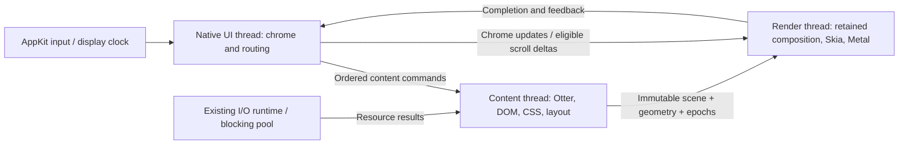

# Browser rendering and thread isolation

Research: 2026-10-14. Otlyra inspected at `12c954b`.
Scope: macOS startup, browser chrome responsiveness, page rendering and scrolling.
The first follow-up removes the
UI's synchronous first-frame/resize wait and splits render/report startup marks;
the audit table describes the inspected baseline, including that former wait.
The second follow-up implements one content owner for normal window startup;
headless Browser APIs remain synchronous.

## Conclusion

Otlyra already has retained display lists, damage tracking, scroll reuse, a render
thread, background I/O and direct Metal rasterization. The missing boundary is
between browser UI and page execution in the inspected baseline: `Browser`
owned `PageWorld` on the native event-loop thread. A render worker alone cannot isolate the address bar
from JavaScript, style or layout running before a frame is submitted.

Fix that boundary while keeping Otter, our DOM/CSS/layout/text stack and Skia.
First measure message delivery and remove synchronous frame waits; then move
page ownership behind a command/snapshot boundary. Independent compositor
scrolling and display-driven scheduling follow that prerequisite.

Windowed startup now constructs Browser and PageWorld on their content owner;
native chrome receives retained scenes and read models. The remaining limits
and acceptance work are recorded in [the implementation follow-up](#content-owner-follow-up).

## Content owner follow-up

`WindowBrowser` keeps address editing, tab-strip interaction and chrome layout
on native UI. Parsing, Otter turns, timers/rAF, DOM/style/layout, page hit testing,
inspector and system-tab rendering stay on the content owner. The local Browser
and its synchronous DOM/driver APIs remain available to screenshots, MCP and
BiDi. No engine changes or `unsafe Send` are needed.

The regression runs an actual 500 ms JavaScript timer callback at 1x and 2x.
While it is still running, UI types an address, creates/selects/closes tabs and
rasterizes two CPU frames. Tests also cover stale document input, pointer/frame
coalescing, copy/paste thread affinity, pre-frame focus, inspector search, native
file-request generations, nonblocking close and cached DPI scaling. About
composites match the synchronous path pixel for pixel at both scales.

This proves separation of native input and chrome from the busy content task.
CPU frame-pump durations are not native input-to-present latency. One content
owner still serializes tabs and inspector work. The retained-damage follow-up
below now accumulates partial updates through render acknowledgements;
Chrome accessibility now retains unchanged document nodes and publishes deltas
as described below. Tab visibility and background rAF now follow the
[visibility contract](#tab-visibility-follow-up) and
[native window propagation](#native-window-visibility-follow-up). Independent scrolling,
content/raster interruption and shutdown persistence remain explicit follow-ups.
An early UI-only frame can be shown before content is ready. Startup reporting
uses the readiness captured on the submitted render job, so late content receipt
cannot reclassify that frame. The first complete content frame retains the strict
budgets; its construction/raster/report intervals are measured together.

### Measurements for this follow-up

Measured on Apple M1, macOS 26.5, release, 1024×768 logical at 2x, with empty
isolated profiles. Each renderer used two warmups and 20 alternating-order
matched process pairs against `dd3fc42`. Both binaries use the same read-only
Otter source snapshot (`23c5a114f769`); the working Otter checkout was left
untouched. Candidate binary SHA-256 starts `e105bf90db60`, control `dfb6b12b687a`.
Values below are p50 / p95 in milliseconds, using nearest-rank percentiles.

| Measurement | GPU control | GPU candidate | CPU control | CPU candidate |
| --- | ---: | ---: | ---: | ---: |
| Process to visibility request | 182.26 / 193.32 | 183.30 / 206.93 | 173.12 / 184.36 | 173.54 / 195.48 |
| Process to first complete content frame report | 278.88 / 295.38 | 275.62 / 303.52 | 261.63 / 278.31 | 259.29 / 273.50 |
| UI frame construction (`chrome_build`) | 7.83 / 7.98 | 0.53 / 0.65 | 7.61 / 8.16 | 0.51 / 0.58 |
| Raster execution (`chrome_raster`) | 27.84 / 31.49 | 32.33 / 37.84 | 24.63 / 28.63 | 28.85 / 31.05 |

The paired median first-frame change is −1.36 ms for GPU and −4.54 ms for CPU.
The UI construction interval excludes page work now performed by the owner;
this is an ownership improvement, not an equivalent reduction in total rendering
work. Raster duration increased, and GPU startup p95 and visibility p95 worsened
in this run. All four strict startup budgets still fail for each renderer
(visibility 50 / 100 ms, first complete frame 100 / 150 ms). Visibility is the
native visibility request; the frame endpoint is UI accounting of a renderer
report, not OS presentation feedback.

Five repeated slow-JS tests per scale measured a 500.81 / 501.31 ms callback at
1x and 500.57 / 500.98 ms at 2x. The UI input batch took 0.26 / 1.45 ms and
0.25 / 0.36 ms respectively, while input plus two CPU frames took 42.13 / 55.50 ms
and 41.45 / 53.93 ms. Every sample completed those operations before the callback
returned. With five samples, p95 is the maximum; these are adapter/CPU-pump
measurements and do not establish native input-to-present or 120 Hz performance.

Local artifacts: `target/startup-content-owner-{gpu,cpu}.json`,
`target/content-owner-build-pair.json`,
`target/content-owner-responsiveness-10.json`, and
`target/content-owner-about-{1x,2x}.png`. Validation covers the full workspace,
the opt-in native GPU/CPU startup smoke, all-target clippy, formatting, and the
seven startup-benchmark protocol tests. The workspace has 1,746 passing tests
and one intentionally ignored desktop smoke; explicitly running that smoke
adds one passing test.

## Retained damage follow-up

The content owner previously replaced every bounded dirty rectangle with full
layer damage, and native composition did the same. This kept coalesced updates
correct but made a keystroke re-rasterize the entire page. Content publications
now preserve their rectangles. Replacing an unconsumed mailbox scene or a cached
UI scene accumulates unacknowledged damage; unknown damage dominates the union.
An unchanged epoch preserves existing damage without adding a new change.

The new `Painter::frame_complete` notification follows renderer completion,
before another frame is composed. Successful frames clear only matching cached
tab/viewport/layer versions. An old completion leaves newer cached changes
pending; dropped or occluded frames acknowledge no pixels. Activation and
geometry changes keep full redraws, including source scenes temporarily scaled
for another DPI. There is one accumulated rectangle per cached layer, with no
unbounded damage journal or new content-thread wait.

Regression coverage compares partial rasterization with a fresh full surface,
including two distant changed rectangles with an intermediate scene skipped,
1x/2x field input, coalesced layout changes, dropped frames and a result arriving
while an older frame is in flight. The shared CPU/GPU damage planner remains
unchanged. Startup still needs a complete first raster; this change targets
subsequent updates and does not establish native input-to-present latency.

Measured on Apple M1 / macOS 26.5 with the debug CPU backend, 900×640 logical,
two warmups and 20 alternating-order same-scene pairs per scale. The control
forces full layer damage for the same prepared scene; both paths use the same
binary and damage planner, and every pair matches pixel for pixel. Timings cover
FramePump rasterization/readback and copying scene handles, excluding native
presentation, content execution, layout and chrome construction. Values are
p50 / p95 in milliseconds, using nearest-rank percentiles.

| Scale | Full layer damage | Partial field damage | Rasterized pixels, full → partial |
| --- | ---: | ---: | ---: |
| 1x | 0.199 / 0.231 | 0.037 / 0.049 | 505,800 → 8,228 |
| 2x | 0.723 / 0.791 | 0.080 / 0.108 | 2,023,200 → 32,912 |

This field fixture redraws 98.37% fewer page pixels. GPU uses the same planner,
but these CPU timings do not measure GPU speed. Raw samples and build metadata
are in `target/content-damage-cpu-pairs.json`. Validation: 1,753 workspace tests
passed, the one ignored desktop smoke passed explicitly for native GPU/CPU,
all-target clippy passed with warnings denied, and the 22 boundary tests passed
after the final test-fixture update. Builds use the earlier read-only Otter
snapshot (`23c5a114f769`), leaving the working Otter checkout unchanged.

## Incremental window accessibility follow-up

Native chrome edits previously cloned the complete retained document into a
window update. The platform then cloned that update again to retain the latest
tree. Window publication now keeps the immutable document Arc and emits only
changed controls, parent child lists, titles or focus. A focus-only update has no
nodes; unchanged wakes/hover return no update. Content preserves equal snapshots
within the same tab/navigation generation. Navigation invalidation removes old
document nodes before the owner can answer.

The platform retains the current graph with `accesskit_consumer` (the existing
adapter dependency, pinned at the same version). Late activation materializes a
complete tree, rather than returning the last partial update. Consumer-backed
tests validate document replacement, removals, focus changes and busy-owner tab
projection. Text fields now carry focus IDs even when empty. Focus is resolved
inside chrome/system surfaces before joining them; their local IDs can overlap.
Bookmark/loading transitions and tab focus-prefix changes invalidate toolbar
semantics. Shared datalist options are exposed under one current field and apply
to that field; exposing the same option under two fields produced an invalid
AccessKit graph and is now covered by a regression.

On Apple M1 / macOS 26.5, the debug publisher comparison used a prepared document
with 10,000 leaf nodes, two warmups and 20 alternating-order matched input pairs.
Full publication emitted 10,003 nodes per edit; incremental publication emitted
one changed address node and zero document nodes. Publisher time p50 / p95 was
1.6679 / 2.9902 ms for the full path and 0.0150 / 0.0242 ms for the incremental
path. This excludes DOM/tree generation, native adapter processing and
presentation, and does not establish native input-to-present latency. Raw samples
and build metadata are in `target/accessibility-chrome-pairs.json`.

Validation: 1,764 workspace tests passed, the desktop GPU/CPU startup smoke
passed explicitly, and all-target clippy passed with warnings denied. Builds use
the read-only Otter snapshot `23c5a114f769`; the working engine checkout is
unchanged. Content still regenerates full accessibility snapshots after semantic
invalidations; equal-snapshot comparison and native initial-tree materialization
still walk the document. Incremental DOM generation remains a separate follow-up.

## Tab visibility follow-up

The document's visibility is initialized from the active tab before parsing
runs its first script. Switching tabs updates the old document to hidden before
exposing the new one, on the content owner. This covers finished pages, parsers
paused at an external script, and parsed documents waiting for subresources.
Encoding reparses preserve visibility. Reordering a tab or selecting the already
active tab emits no extra event; successive ordered tab intents retain their
transitions even within one input batch.

`visibilitychange` reports the new state, bubbles from document to window and
uses the normal event/microtask path. The initial state fires no change event.
Both `addEventListener` and `document.onvisibilitychange` are supported. This
follows the [HTML visibility steps](https://html.spec.whatwg.org/multipage/interaction.html#page-visibility).

The frame pump looks up only the active slot instead of entering every tab's
isolate. Hidden documents retain their animation callbacks, including callbacks
registered during loading. The deferred-load flush also skips hidden frames;
load events and timers still run. Activation resumes queued callbacks with the
normal current frame timestamp, without replaying missed frames. The
[HTML rendering algorithm](https://html.spec.whatwg.org/multipage/webappapis.html#update-the-rendering)
excludes hidden documents before animation-frame callbacks.

Regression coverage uses actual JavaScript and tab commands: forty foreground
frame pumps execute zero callbacks in the hidden animation loop, while its timer
runs and reports hidden. Returning to the tab resumes its pending callback and
Vsync request. Other cases cover background document arrival, a parser-blocking
external script, handler replacement/removal, bubbling and microtasks, encoding
reset, cancellation while hidden, closing/reordering tabs and repeated selection.
The window adapter is tested through its ordered command boundary; visibility
listeners run on `otlyra-content`.

Verification: 1,771 workspace Rust tests passed, plus the opt-in native GPU/CPU
startup smoke; all-target clippy with `-D warnings`, formatting and diff checks
passed. Builds use the same immutable Otter snapshot as the preceding follow-ups;
the working Otter checkout was not edited.

This removes unnecessary background animation execution; it is not an
end-to-end CPU, energy or native input-to-present benchmark. Native window
occlusion/minimization is implemented by the follow-up below. Timer budgets,
media exemptions and visibility performance entries remain follow-ups. One
content owner still serializes page tasks and visibility listeners.

## Native window visibility follow-up

Native window visibility now reaches content through an ordered, window-wide
command. UI immediately stops its Vsync requests while the owner is busy; stale
snapshots cannot reactivate the hidden window. Quick hide/show transitions retain
their visibility events, and duplicate states produce no extra event. Tab
selection stays independent: switching inside a hidden window exposes no page,
and restoration exposes only the selected tab. New documents loaded while hidden
report hidden in their first script.

The native loop uses confirmed occlusion and minimized state, preserving unknown
query results. Focus loss does not hide a visible window. On macOS, winit maps
AppKit's occlusion-state changes to `Occluded`; minimize/restore is queried during
native resize, focus, occlusion and redraw events. Platform support is bounded by
the pinned winit version: occlusion is unavailable on Windows/Wayland, and the
minimized query returns unknown on Wayland. Those unknown states are not inferred
from focus or zero-sized drawable geometry.
[Pinned event source](https://github.com/rust-windowing/winit/blob/7d20408d33210c93bf036335b88ee083ca563a90/winit-core/src/event.rs),
[window state query](https://github.com/rust-windowing/winit/blob/7d20408d33210c93bf036335b88ee083ca563a90/winit-core/src/window.rs),
[AppKit bridge](https://github.com/rust-windowing/winit/blob/7d20408d33210c93bf036335b88ee083ca563a90/winit-appkit/src/window_delegate.rs).

Known-hidden redraw requests submit no raster jobs. Old visual deadlines and
unsubmitted redraws are cancelled; the painter retains its pending damage.
A job already submitted still reports, releasing the flight slot. A completion
while hidden does not acknowledge presentation or satisfy the startup report.
Restoration requests a fresh frame at the current native viewport, keeping the
existing one-job limit. For synchronous painters, timer deadlines wake their
event pump without painting; WindowBrowser's owner schedules its timers itself.
Non-advancing visual deadlines are discarded while hidden to prevent a busy loop.

Tests exercise real JavaScript visibility/rAF/timers and the native command
boundary while content is blocked. Forty hidden pumps execute no rAF callbacks.
A controlled render worker also receives no extra job during forty hidden redraws;
its late completion retains damage, and restoration uses the latest viewport.
Other checks cover loading without spinner Vsync, initial hidden state, tab
changes, duplicate/rapid transitions, unknown native queries and hidden timer
deadlines. These are deterministic protocol checks rather than an energy or
input-to-present benchmark; manual native minimize/restore is not part of them.

Verification: 1,778 workspace Rust tests passed, plus the opt-in native GPU/CPU
startup smoke. All-target clippy with `-D warnings`, formatting and diff checks
passed against the same immutable Otter snapshot; its working checkout was not
edited. These checks do not establish a new startup latency distribution.

Timers and resource loads continue. Hidden scene preparation was addressed in
the following step; timer budgets, exemptions and interruptible content tasks
remain separate work.

## Hidden content preparation follow-up

The content owner's snapshot now distinguishes metadata from a prepared scene.
While the window is hidden it pumps timers, parsing and completed resources but
does not compose content, refresh find geometry or generate document
accessibility. Page style/layout invalidations remain pending. Existing loads
continue; CSS images/fonts discovered only by visual preparation can start later.

Metadata does not replace the UI's retained scene. A tab/navigation change clears
the retired document accessibility; the first visible snapshot prepares the new
tree. Restoration forces full scene damage at the latest viewport, also covering
an unconsumed scene overwritten by hidden metadata. Geometry-bound input can
prepare content explicitly before hit testing or accessibility actions, so a
restore and pointer event in one command batch use current layout.

Tests cover real hidden JavaScript timers moving and changing a field without
additional display-list builds, retained accessibility/list identity, initial
hidden loading, a 2x resize, hidden navigation, same-batch restore/input, and
unconsumed visible damage. Resumed CPU output is compared with a fresh full
surface at 1x/2x. This is functional evidence, not a native energy or latency
distribution. Identical metadata publications were suppressed in the follow-up
below.

Verification: 1,783 workspace Rust tests passed with no failures; all-target
clippy with `-D warnings`, formatting, diff checks and the opt-in native GPU/CPU
startup smoke passed against the same immutable Otter snapshot. The working
Otter checkout was not edited.

## Cookie persistence follow-up

Browser pumps and cookie-removal actions now schedule a revision instead of
serializing, sealing and replacing the cookie file inline. A lazy single writer
coalesces requests to the newest jar state. It copies the jar and revision under
one lock, then releases both jar and scheduler locks for key lookup, formatting,
sealing and I/O. Refused key lookup is remembered; it writes no plaintext and
does not retry indefinitely.

The written revision advances only after successful atomic replacement and sync,
fixing the previous skipped-retry failure. Writes use unique temporary names;
file sync precedes rename and directory sync follows it on Unix. Errors preserve
the pending revision and retry after one second without another browser pump.
Explicit `CookieStore::flush` remains a blocking success/failure barrier for
legacy migration. Its source is removed only after that barrier succeeds.

`WindowBrowser::Drop` still sends shutdown without joining. Normal native CLI
startup retains the content thread handle and joins it after `run_window`
returns; cookie-store destruction drains pending changes on content. Profile
reads and legacy migration remain synchronous during profile loading. Fetch
ownership was addressed in the following step. Independent download saves
and started blocking tasks remain separate shutdown work.

Controlled tests hold a write while forty revisions are scheduled: scheduling
and jar mutation continue, and only the first and latest snapshots are written.
Other tests cover failed replacement and retry of an unchanged revision, retry
without pumping, unscheduled final changes, session-cookie exclusion, refused
keys, a failed worker releasing waiters, legacy migration failure/success,
nonblocking native close and post-loop shutdown durability. These checks prove
ownership and persistence behavior; they do not establish saved-profile startup
or native input-to-present latency distributions.

Verification: 1,794 workspace Rust tests passed, plus the opt-in native GPU/CPU
startup smoke. All-target clippy with `-D warnings`, formatting and diff checks
passed using the same immutable Otter snapshot; its working checkout was not
edited.

## Fetch ownership and shutdown follow-up

Each fetch pool now retains its transport tasks in a `JoinSet` on the existing
shared I/O runtime. Finished handles are reclaimed during normal use. Pool
destruction closes its permit queue, suppresses its waker and aborts without
joining. Closing permits before aborting prevents released slots from starting
queued transports during teardown; other pools and the shared runtime continue.

Native content exits its command loop before cancellation, drains cooperative
transport futures, then drops its cookie store. It discards completed replies
without parsing, running scripts or requesting further resources. Cookie updates
inside native transport finish before the final snapshot. This drain runs on
content's owner; the CLI's join remains after the native event loop returns.
The early failed metadata-handoff path uses the same boundary.

A completion guard sends one failure and wakes the owner when an async transport
panics, so navigation does not wait indefinitely for a missing reply. Teardown
suppresses these wakes and discards cancellation replies. Started blocking
loaders/decoders cannot be interrupted by aborting their awaiting task;
independent download saves and blocking I/O still need an explicit exit policy.

Tests cover active/queued cancellation, isolation of two pools, handle reclamation,
async panic delivery, and a transport cancellation held before changing the
cookie jar. Post-loop shutdown must persist that final change rather than the
earlier file. These tests establish task ownership and final snapshot ordering,
not native input latency or startup performance improvements.

Verification: 1,799 workspace Rust tests passed, plus the opt-in native GPU/CPU
startup smoke. All-target clippy with `-D warnings`, formatting and diff checks
passed against the same immutable Otter snapshot. The working Otter checkout
was not edited.

## Hidden metadata publication follow-up

Snapshots now separate a prepared scene from immutable shared metadata. The
content owner retains its last hidden metadata handle and suppresses identical
publications, avoiding native UI wakes caused by timers or commands that change
only deferred document state. It continues pumping and uses each newly computed
timer deadline locally, even when it publishes nothing.

Equality includes ordered command serials, tabs/loading/navigation/title,
viewport, focus/cursor, find/bookmark state, zoom/theme, work counters and context
menus; document semantics, system descriptions and suggestions use retained
handles. Labels are derived from tabs. System descriptions now reuse a shared
handle while unchanged. Visibility restoration always publishes current data and
a prepared scene; a suppressed hidden publication still invalidates the resumed
scene's full-damage context.

Tests observe no new publication or native wake across one hundred unchanged
hidden commands, including with an open context menu. They verify changed menu
payloads, title, viewport, ordered acknowledgements and projected tabs still
arrive, and restoration publishes again. Existing real timer, damage and 1x/2x
pixel-parity tests remain covered. This proves publication behavior; it is not
a measured background CPU/energy improvement or a timer budget.

Verification: 1,802 workspace Rust tests passed, plus the opt-in native GPU/CPU
startup smoke. All-target clippy with `-D warnings`, formatting and diff checks
passed on the immutable Otter snapshot, leaving its working checkout unchanged.

## Browser accessibility action follow-up

The interface and system-page handlers previously treated native Focus,
Increment and Decrement like activation. Focusing an About button could navigate;
focusing a cookie-removal control could remove cookies. The existing platform
converter already distinguished all four intents, but browser-owned handlers
ignored the action. They now share a resolver using the existing widget focus,
activation and adjustment paths. Page DOM handling remains on its existing path.

Focus changes no setting, navigation or cookie. Activate keeps the click behavior;
range requests use the slider's own step. Disabled/unfocusable nodes and
unsupported adjustments leave focus/model unchanged. Interface headings no longer
advertise Click; enabled focusable controls advertise Focus, and sliders expose
numeric values plus Increment/Decrement. Existing activation helpers retain their
public API.

Range widgets now advance their current value when accepting pointer or keyboard
input. Repeated steps before another frame previously used the old value and
collapsed to one step; they now accumulate and retain clamping. Tests cover About,
cookie removal, settings toggles/ranges, and threaded native New-tab focus versus
activation. Dynamic control/node ids still need semantic identity: their current
layout indices, including focus ids, do not provide a stable queued target.

Verification: 1,807 workspace Rust tests passed, plus the opt-in native GPU/CPU
startup smoke. All-target clippy with `-D warnings`, formatting and diff checks
passed against the same immutable Otter snapshot; its working checkout was not
edited.

## Script viewport compatibility follow-up

Windowed factories are aligned with the shell's requested viewport and chrome
mode before ready loads can run their first scripts. Otlyra's DOM bindings now
expose replaceable `innerWidth`, `innerHeight` and `devicePixelRatio` getters,
using CSS dimensions and native scale multiplied by the document's page zoom.
The viewport excludes chrome and the inspector dock. Each background document
retains its own zoom when another tab is selected.

Resizing updates metrics and invokes window resize listeners on content's owner,
including handlers assigned through `onresize` and their microtasks. Paused
parser runners receive the update; encoding resets retain both viewport and
visibility. Identical dimensions and changes to DPR alone do not fire resize.
Property assignment preserves the script's replacement value on later updates.
This follows the [CSSOM View Window interface](https://drafts.csswg.org/cssom-view/#extensions-to-the-window-interface)
and its [viewport resize steps](https://drafts.csswg.org/cssom-view/#resizing-viewports).

Regression coverage checks the first inline script at 1x/2x with and without
chrome, initially hidden loading, repeated resize and DPR changes, document zoom,
inspector docking, parser blocking and script property replacement. This step
used the requested shell viewport; native scale confirmation is addressed below.

Verification: 1,813 workspace Rust tests passed, plus the native GPU/CPU startup
smoke and seven benchmark-protocol Python tests. All-target clippy with
`-D warnings`, formatting and diff checks passed on the immutable Otter snapshot.

The startup check used three warmups and 20 alternating baseline/candidate pairs
per renderer on Apple M1/macOS 26.5, release, 1024×768 logical at 2x,
`about:about`, isolated profiles and `--no-secrets`. The driver cache was warm;
local background build load was present. Both binaries use Rust 1.96.0 and the
same frozen engine/Skia archive. Workspace packages were explicitly cleaned
between source trees to prevent Cargo from reusing the control executable.
Control SHA-256 begins `c07d20ee18fd`, candidate `ee9a56b8a8aa`.

| Startup, p50 / p95 ms | Control `331c16d` | Candidate |
| --- | ---: | ---: |
| GPU visibility request | 195.35 / 226.23 | 196.28 / 234.33 |
| GPU complete content-frame report | 291.42 / 311.54 | 290.83 / 316.77 |
| CPU visibility request | 183.73 / 198.96 | 181.13 / 197.82 |
| CPU complete content-frame report | 274.03 / 295.33 | 270.05 / 285.88 |

Paired first-frame median changes were −2.59 ms GPU and −7.72 ms CPU. GPU tail
latency worsened; this compatibility change establishes no startup speedup.
All strict startup budgets still fail. The endpoints retain native visibility
request and UI report-accounting semantics. Local artifacts are
`target/startup-viewport-{gpu,cpu}.json` and `target/viewport-build-pair.json`.

## Native initial viewport follow-up

A real-window probe confirmed that the first inline script could read DPR 3
from `--scale-factor 3` while the native startup report said DPR 2. That CLI
parameter belongs to screenshots; native windows must use the OS scale. The
content factory's requested viewport alone could not guarantee that.

Normal native startup now uses `WindowBrowser::spawn_native`. It hands initial
metadata (including palette, pinned appearance, zoom and bookmark state) to
chrome, attaches service wakers without pumping responses, and waits
on content's owner for the existing `SurfaceReady` event. Actual dimensions and
scale are installed before the first script or scene. Network requests may
complete during the wait; their responses remain queued. The buffered appearance,
visibility and input prefix is replayed before the first pump, so scripts and
the initial scene see the OS environment. Chrome projects tab intents immediately,
buffered commands retain order, and close before surface
confirmation discards pending commands and performs the usual fetch shutdown.
The known-viewport `spawn` and `spawn_with_trace` APIs keep immediate execution.

Startup records `content_surface_ready`; the benchmark separates native surface
delivery and content preparation after confirmation. The older
`first_content_scene` interval includes waiting from owner setup and is not a
measure of CPU work. Tests cover the mismatched nominal/confirmed scale at
1x/2x, chrome input before confirmation and early shutdown. Native desktop smoke
loads both About and an inline-script fixture on GPU/CPU; it checks the first
script against actual surface metrics with the screenshot scale forced to 3.

Verification: 1,818 workspace Rust tests, the four-case native GPU/CPU desktop
smoke, all-target clippy with `-D warnings`, formatting, diff checks and seven
Python benchmark tests passed. The frozen engine digest remains `23c5a114f769`.

The final startup comparison repeats the viewport follow-up's setup: three
warmups and 20 alternating pairs per renderer, warm driver cache, isolated
`about:about` profiles and local background build load. Control is `c9f303a`
(SHA-256 `ee9a56b8a8aa`); candidate SHA-256 begins `9dff2e98c5ca`.

| Startup, p50 / p95 ms | Control | Candidate |
| --- | ---: | ---: |
| GPU visibility request | 214.50 / 235.90 | 214.82 / 229.97 |
| GPU complete content-frame report | 321.09 / 358.50 | 329.46 / 350.02 |
| CPU visibility request | 219.99 / 232.23 | 212.99 / 229.86 |
| CPU complete content-frame report | 328.52 / 344.00 | 315.15 / 333.80 |

Paired first-frame median changes are +0.76 ms GPU and −9.54 ms CPU. GPU median
startup is higher in the unpaired quantile; this run establishes correct initial
metrics, not a startup speedup. All strict startup budgets still fail. The
confirmation-to-first-scene interval is 18.60 / 24.60 ms GPU and 15.90 / 25.81 ms
CPU, including replayed environment commands and scene preparation. Native
visibility and renderer-report endpoints keep their previous accounting meaning.
Artifacts: `target/startup-native-surface-{gpu,cpu}.json`,
`target/native-surface-build-pair.json`, and the before/after native DPR probes
in `target/native-metrics-{before,after}.{json,log}`. Earlier pilot binaries and
measurements are retained separately and are not mixed with this final series.

## Retained action target follow-up

Tab buttons previously stored layout indices. Receiving a reordered model before
the next chrome frame could make a click on the retained second tab select or
close a different tab. Controls now store their TabId; native projections and
the synchronous Browser resolve it when acting. Closed targets are ignored.
Existing index actions retain their API for current-index commands and shortcuts.

Content input contexts now include system-page kind as well as navigation id.
About pages retain the last navigation id, which previously allowed queued
document or system-page input to cross a replacement. The owner rejects those
commands while acknowledging their serial. Accessibility metadata uses the same
context, clearing retired document nodes and hidden system descriptions instead
of retaining them under the new surface's title.

Tests exercise 1x/2x retained tab controls after owner reorder, a retired close
button, synchronous Browser routing, queued pointer input across document/about
replacements, hidden system navigation and document accessibility retirement.
This secures targets captured when commands enter the queue; positional native
accessibility ids still need stable semantic identity across tree publications.

Verification: 1,824 workspace Rust tests passed, including existing interface
goldens, surface snapshots and compositor interaction tests, plus the four-case
native GPU/CPU startup smoke. All-target clippy with `-D warnings`, formatting
and diff checks passed against the unchanged frozen engine snapshot.

## Download write ownership follow-up

Download saves previously discarded their Tokio handles. Ending the content
owner therefore did not wait for accepted filesystem writes, even though native
CLI shutdown joined that owner. The download writer now retains its tasks and
reaps completed handles on save/poll. Shutdown suppresses its completion wakes,
cancels/drains fetch work, then finishes accepted saves and collects their
terminal results before final cookie persistence. Unused writers create no I/O
runtime just to shut down.

`DownloadWriter::finish` awaits handles by mutable reference; dropping the drain
retains unfinished writes so it can be resumed. This uses Tokio's documented
[JoinHandle cancellation guarantee](https://docs.rs/tokio/latest/tokio/task/struct.JoinHandle.html#cancel-safety),
also checked in the pinned 1.53.0 source. Normal shutdown does not abort file
operations. A completion guard reports a terminal failure for a panicked or
externally aborted task, including one canceled before its first poll.

Tests hold writes behind a gate and prove that native Drop returns while the
owner stays alive, then that file replacement completes before owner exit. Both
known-viewport owners and close before native `SurfaceReady` are covered. Other
tests check a multi-file drain, canceled/resumed drain with no teardown wake,
and single terminal replies for panic/abort. Started blocking loader/decode jobs
remain outside this download-specific drain policy.

Verification: 1,828 workspace Rust tests, the four-case native GPU/CPU startup
smoke, all-target clippy with `-D warnings`, formatting and diff checks passed
on the unchanged frozen engine snapshot.

## Timer task scheduling follow-up

The timer wheel previously removed every due token before any callback ran, and
the content pump executed the entire cohort before reading another command.
Two hundred one-ms callbacks therefore occupied content for their whole cohort.
`settle` also tested the next deadline rather than time already spent, allowing
an overdue cohort to exceed its nominal budget.

The wheel now supports taking one due token while preserving the ordering and
deadlines of the rest. PageScripts yields after a four-ms soft slice, checking
only after each complete callback and its microtask checkpoint. PageWorld shares
an eight-ms soft deadline across documents and resumes from the next slot after
exhaustion. Its rotating index uses no per-pump tab-vector allocation and tolerates
map-size changes. Settle checks elapsed time and passes its remaining deadline.
The ScriptRunner extension has a default preserving existing runner behavior.

These are scheduling deadlines between tasks; a single long callback can overrun
them and keeps the existing watchdog. Requested timer delays and hidden-page
exemptions have not been changed. Timers are independently queued tasks in the
[HTML timer algorithm](https://html.spec.whatwg.org/multipage/timers-and-user-prompts.html#timers),
so unfinished work stays eligible instead of being discarded on a yield.

Tests cover cancellation of a still-queued neighbor, microtasks before yielding,
retained/new timer ordering, elapsed settle limits, fair progress through busy
slots, cursor reset after clearing them, and a real JS cohort interrupted by an
owner command. The same queue regression fails against `33804de`: its command
waits for all 200 callbacks. The startup benchmark now accepts `--url`, retaining
About as its default and the existing budget gates, to measure a local scripted
fixture separately from an empty system page.

The matched queue experiment used 20 alternating-order fresh-process pairs after
three warmups, the same harness and frozen engine digest. Content-owner command
acknowledgement p50/p95 fell from **221.25/248.64 ms to 8.74/13.53 ms**. Before
acknowledgement the control completed all 200 callbacks; the candidate completed
3–5. This measures owner queue responsiveness, not native input-to-presentation
latency or faster total JavaScript execution. Raw pairs and binary hashes are in
`target/timer-queue-pairs.json` and `target/timer-budget-build-pair.json`.

Separate release startup comparisons used 20 alternating-order pairs after three
warmups per workload/backend, at 1024×768 logical pixels and native 2× scale on
Apple M1/macOS 26.5. The local web fixture schedules the same 200 one-ms callbacks.
The measured interval is process launch to the first content-frame report handled
by UI; it does not prove physical presentation or completion of the whole cohort.

| Workload/backend | Control p50/p95, ms | Candidate p50/p95, ms | Paired delta p50, ms |
| --- | --- | --- | --- |
| About / GPU | 319.27 / 399.09 | 324.43 / 354.64 | −12.37 |
| About / CPU | 317.05 / 357.19 | 320.27 / 349.16 | −4.57 |
| Timer fixture / GPU | 497.30 / 530.20 | 335.57 / 376.51 | −157.81 |
| Timer fixture / CPU | 511.31 / 536.58 | 353.61 / 405.61 | −153.30 |

About startup has no demonstrated median improvement; the timer fixture can show
its first content before completing all callbacks. Every candidate run still
fails all four existing strict startup percentile gates, which remain unchanged.
This is a responsiveness improvement under timer load, not a general startup
speedup. Full artifacts are `target/startup-timer-budget-{about,web}-{gpu,cpu}.json`
and `target/timer-startup-fixture.json`; the control is `33804de` and release
candidate hash is `1a0931e8d350940977a0a104353acf8416c3234cd9cd2167036e566513e448f1`.

Validation: 1,832 workspace tests passed, plus all-target clippy with warnings
denied, formatting/diff checks, seven benchmark protocol tests, and native About
and web startup smoke on both GPU and CPU. The engine snapshot digest remains
`23c5a114f769905e46bc028b747eba16ab7525b1689ef2a17836e120fc65dcba`.

## Native context-menu lifetime follow-up

An owner-side navigation already discarded its context target and menu, but the
native shell only copied an offered menu when acknowledging a request. It did
not retire a previously displayed menu when a later publication removed it.
Context row commands also lacked the document guard used by page input: if a
replacement page opened its own menu before a queued old command ran, that
command could consume the replacement's target.

The shell now remembers the TabId and content context (navigation plus system
page kind) for each native menu request. It retires the native content menu when
that source changes or the owner dismisses it, independently of newer keyboard
focus commands. An acknowledgement without rows clears the pending request.
Row commands validate the source on UI and carry the existing content-context
guard through the owner queue. The shared BrowserUi popup/dismissal machinery
is retained, including the distinct lifetime of the browser menu.

Three regressions reproduce the old behavior against `ce2d2cf`: owner navigation
left old rows visible, explicit owner dismissal did not close the native copy,
and a queued Select All could select a replacement document through its new menu
target. All pass with the fix. Additional coverage checks DOM-to-system
replacement with an unchanged navigation ID, successful current-menu commands
after native dismissal, empty-menu acknowledgements, and browser-menu retention.

Validation: 1,838 workspace tests passed with one test thread, all-target clippy
with warnings denied, formatting/diff checks, and native GPU/CPU About/web
startup smoke. The first parallel suite hit the pre-existing two-CPU-frame
responsiveness threshold at 2× (220.16 ms versus its unchanged 200 ms limit).
Isolated execution passed at 39.49 ms (1×) and 36.62 ms (2×) while the real JS
callback remained busy for 500 ms; the full serial suite also passed. This
contention result is retained in `target/context-menu-workspace.log`, alongside
`target/context-menu-workspace-serial.log` and `target/context-menu-responsiveness.log`.

## Native bootstrap phase attribution

The startup trace now distinguishes event-loop preparation from the native build
call, encoded-image preparation from Dock icon installation, and menu validation,
root/submenu/item creation, root attachment and application-menu installation.
Window-attribute preparation is separate from hidden native window creation.
Optional trace marks keep the existing platform path and public startup report
schema; the benchmark extracts intervals per run and skips unavailable pairs in
older reports. Eight protocol tests cover the additional intervals and preserve
the existing four strict percentile gates.

These marks measure elapsed intervals around native calls, including lazy work
performed inside them. For example, the image-creation marker does not prove
that AppKit has eagerly decoded every representation. The separate `sample`
probes ended without useful call graphs because the auto-exiting app completed
too quickly, so they provide no stack-attribution evidence and are excluded from
the timing distributions. Internal AppKit/dyld attribution remains follow-up.

On Apple M1/macOS 26.5 at 1024×768 logical/2× native scale, the diagnostic release
used 20 alternating-order pairs after three warmups per backend. Every phase
below has all 20 candidate samples (p50/p95 in ms):

| Elapsed native interval | GPU series | CPU series |
| --- | --- | --- |
| Native event-loop build | 72.82 / 88.41 | 66.17 / 76.49 |
| Encoded-image preparation | 1.58 / 2.32 | 1.41 / 1.60 |
| Dock icon installation | 31.32 / 37.21 | 29.51 / 30.53 |
| Menu object creation | 6.24 / 8.86 | 6.46 / 12.22 |
| Application-menu installation | 19.65 / 25.78 | 18.79 / 23.63 |
| Hidden native window creation | 48.08 / 52.76 | 44.53 / 51.15 |
| Confirmed surface → first scene | 46.32 / 61.00 | 21.13 / 29.37 |
| GPU device/presenter setup | 20.11 / 51.42 | 8.00 / 20.13 |

Menu validation is only 0.024 ms at p50, root creation 0.08 ms and first root
attachment 0.12–0.13 ms. The larger menu cost is installation, rather than
accelerator validation or copying the first submenu. Icon and menu setup
currently precede hidden-window creation, so they also precede confirmed-surface
content work and GPU setup. This identifies an overlap opportunity while
retaining their completion before actual visibility.

System load was substantial and changed between series: one-minute load average
49.76 at the start and 56.39 at completion. Compare matched variants within a
series, not GPU versus CPU rows. Own build/test work had finished before
sampling. About first-frame-report p50/p95 control→candidate was
340.42/422.30→340.08/380.48 ms GPU and 298.76/318.98→290.81/316.64 ms CPU.
Paired median changes were −12.76/−6.04 ms respectively. This diagnostic change
establishes attribution, not a startup speedup; both candidates still fail all
four unchanged strict gates. The control is `ce2d2cf`, candidate parent `0f10d03`;
release hashes, fixed engine/Skia digests and background-load observations are in
`target/native-bootstrap-build-pair.json`. Raw distributions are
`target/startup-native-bootstrap-{gpu,cpu}.json`.

Validation: 1,838 workspace tests with one test thread, all-target clippy with
warnings denied, formatting/diff checks, eight Python protocol tests, and native
About/web startup smoke on both renderers passed.

## Recovering the first native redraw

Controlled startup work exposed an existing first-frame stall. A proposed early
Ready path timed out after 30 seconds, then a separate paired stress run also
stalled the original `14904a2` control. Both sampled processes had the native UI,
content and render threads idle waiting for events, with redraw requests logged
but no frame started. This points to a launch redraw that did not reach the
initial native event batch; it is not evidence of a busy GPU or a content lock.
The failed runs are retained in `target/startup-native-ready-about-gpu.log`,
`target/native-ready-stress/07-candidate-*` and
`target/native-ready-retry-stress/11-control-*`. No timing distribution is
reported from that interrupted experiment.

The retained fix applies to normal renderer readiness: when the initial Ready
report owes the first frame, the loop arms a one-shot 50-ms bootstrap deadline.
It shares the existing ControlFlow/WaitUntil wake mechanism with painter
deadlines, so recovery does not require new input. At that deadline it reissues
that existing redraw only if no frame has started, one is still pending and none
is in flight. Starting a frame or hiding the window cancels the deadline. Hidden-window transitions retain their existing
restore path. Later input, damage and frame coalescing are unchanged.

The native icon/menu/window installation order remains as before. An overlap
pilot completed four 20-pair distributions but showed no clear About benefit:
paired first-frame medians were +1.29 ms GPU and −2.30 ms CPU. The timer fixture
showed −11.32/−14.04 ms, with different background load between series. Those
results do not establish a general startup win, so the reordering and manual
early Ready consumption were not retained. Raw pilot artifacts remain in
`target/startup-native-overlap-{about,web}-{gpu,cpu}.json` and
`target/native-overlap-build-pair.json`.

Two scheduler regressions check one-shot consumption, retention of the owed
frame, skipping started/in-flight work and hidden/restore transitions. Native
About/web GPU/CPU smoke also checks AccessKit, icon and menu readiness before
visibility and verifies first-script viewport/DPI. An explicit attribute-start
mark keeps phase attribution independent of menu completion order.

The initial debug smoke during profiling exposed a stale regular platform
library left by an older copied control tree sharing the Cargo target. The
platform package was explicitly cleaned in dev and release profiles and the
current native smoke repeated. The diagnostic release independently contained
all new phase marks in every measured run; its earlier pre-clean debug smoke
was not evidence that the debug app linked the new platform. Future copied-tree
comparisons must clean every changed own package or use a separate target.

The exact timer workload is tracked at
[`tools/fixtures/startup-timers.html`](../tools/fixtures/startup-timers.html),
SHA-256 `cfd7b5c1e405507b62bae6a31373755326fdcf95a469dec30d5da8a28196012c`.
Select it with the benchmark's `--url file:///absolute/path/to/fixture` option;
About remains the default. Its first content frame may precede all 200 callbacks.

The event-only recovery pilot completed 100 traced starts (60 GPU, 40 CPU),
without a failure; no retry was needed in those runs. Its untraced About
20-sample distributions after three warmups were visible/first-frame-report
p50/p95 190.40/208.49 and 274.74/311.86 ms GPU, 183.52/213.33 and
272.31/299.73 ms CPU. All four strict gates still failed. These are pilot data,
not a before/after speedup claim or coverage of the later deadline branch;
artifacts are `target/startup-recovery-{gpu,cpu}.json` and
`target/startup-recovery-stress/runs.json`.

The retained deadline form has targeted coverage for preserving an unexpired
retry, consuming it once when due, choosing the earliest native wake, and
cancelling after started/in-flight/hidden work. All 48 platform unit tests,
all-target workspace clippy with warnings denied, formatting/diff checks,
eight Python protocol tests and all four native startup cases passed.

## Document animation clocks

The browser inherited an engine fallback where `performance.now()` subtracted a
captured epoch value from `Date.now()`. Replacing Date.now made the result go
backwards. Browser rAF timestamps separately used PageWorld creation time, so a
document opened in an older world used another origin. A regression reproduced
performance.now=177 ms versus a frame timestamp of 600225.80 ms. The deferred
load flush also supplied a constant zero to its first frame callbacks.

Otlyra page turns now use a native monotonic clock with a process-wide estimated
Unix anchor and a shared 100-microsecond grid. Each document records navigation
start before its fetch; the origin therefore includes network/parse wait, not
just isolate construction. Signed ticks support origins preceding first clock
initialization. `performance.now`, timeOrigin/toJSON, normal host frame instants
and the first deferred frame use that same document origin. This follows the
clock separation/coarsening in [High Resolution Time](https://w3c.github.io/hr-time/)
and the callback timestamps in the [HTML animation-frame algorithm](https://html.spec.whatwg.org/multipage/imagebitmap-and-animations.html#animation-frames).

The existing Performance singleton and prototype are retained with receiver
checks. Replacing the global performance object does not invalidate saved methods
on the original singleton. Bare ScriptHost turns without a document loan retain
the engine fallback. ScriptRunner gains a default run_frame_at hook delegating to
its old elapsed-timestamp method; explicit legacy frame callers keep their API.
No Otter source changes are required.

PageState stores an optional clock so the default placeholder created for each
DOM loan does not query system time or create a new clock. Encoding resets keep
the original clock while replacing the isolate. Six regressions/contracts cover
Date.now replacement, late document frames, navigation wait in the first script
and deferred frame, reset continuity, receiver/global replacement and the bare
host fallback. The two defect checks fail against `81b694b` before the fix.

### Final integrated native validation

The deadline-only integrated release still stalled in GPU/About trial 40; its
binary and metadata are preserved as `target/page-clock-before-wake-release`
and `target/page-clock-before-wake-build.json`, with the failed trace/sample in
`target/page-clock-final-stress/40-candidate-*`. It is not a successful stress
series. The native handler now also services due work in `new_events`, before
native redraw dispatch, retaining the existing idle hook.

That final version completed 100 mixed starts: 60 GPU/40 CPU, 50 About/50 timer
fixture, every process successful with a first-frame report. None needed the
bootstrap retry, so this series does not directly cover the rare recovery path;
controlled native fault injection/upstream tracing remains follow-up. All
attempts are retained; failed earlier series were not averaged into results.

The final release also completed 20 fresh processes after three warmups for each
workload/backend, 1024×768 logical pixels at native 2× on Apple M1/macOS 26.5.
These are unpaired distributions, p50/p95 in ms:

| Workload/backend | Process → visible | Process → first content-frame report |
| --- | --- | --- |
| About / GPU | 161.21 / 172.35 | 242.59 / 268.52 |
| About / CPU | 165.21 / 170.98 | 240.98 / 267.83 |
| Timer fixture / GPU | 165.50 / 179.71 | 254.55 / 279.89 |
| Timer fixture / CPU | 166.17 / 179.89 | 263.25 / 282.42 |

Every series still fails all four strict startup percentile gates, unchanged.
These intervals are UI accounting, not physical presentation, and the timer
fixture can show content before all callbacks finish. No general startup
speedup is established from these unpaired data. One-minute system load was
18.13 at series start and 19.79 at completion; own build/check jobs were done.

Final binary SHA-256 is
`bdd5be60e1488d0704794ab7909ac3e2dad3711db244048ba6708b5541f1b6c8`;
source hashes, Rust/Skia/engine provenance and load are in
`target/page-clock-final-build.json`. Raw stress/distributions are
`target/page-clock-wake-stress/runs.json` and
`target/startup-final-{about,web}-{gpu,cpu}.json`.

Final integrated validation: 1,846 workspace tests with one test thread,
all-target clippy with warnings denied, formatting/diff checks, eight benchmark
protocol tests and four native About/web GPU/CPU startup scenarios passed.
The unchanged engine snapshot was rehashed: 1,474 Rust/manifests/lock files still
match `23c5a114f769905e46bc028b747eba16ab7525b1689ef2a17836e120fc65dcba`.
The live sibling Otter checkout was not modified.

## Occluded first presentation

The rare first-frame stall is an occlusion disagreement, not a lost native
redraw. wgpu-hal's Metal surface reads `NSWindow.occlusionState` on the render
thread and refuses the drawable when the Visible bit is absent. Right after
`set_visible(true)` that state can still describe the hidden window while
AppKit has not yet delivered `windowDidChangeOcclusionState:` to the loop. The
render report then says *occluded*; the loop, which believed the window visible
since showing it, asked for nothing more. The later notification reported
`Occluded(false)`, which changed nothing in `WindowVisibility`, so it requested
nothing either. The bootstrap retry did not apply because a frame had started.
The `40-candidate` trace matches this: the Ready-owed frame was submitted and
its report arrived 28 ms later requesting `None`, with no presented-frame log.

A `fault-injection` cargo feature (never in shipped builds) adds
`OTLYRA_FAULT_OCCLUDED_ACQUIRES=N`, refusing the first `N` acquisitions exactly
as Metal does. On the unchanged `7c0fac7` platform code one refusal stalled
8 of 10 traced About starts (GPU and CPU alternating) with the window still
visible to AppKit; the two that completed were rescued by an unrelated later
content redraw. Without injection the same binary completed 4 of 4.

The loop now treats an occluded report for a window it considers visible as a
frame still owed. It retries after 50 ms, doubling to at most once a second,
and also redraws when a visible occlusion notification arrives without a
visibility transition. A presented frame or any visibility transition ends the
state; hidden windows keep the existing no-raster behavior. The startup trace
records `presentation_occluded_while_visible`, `presentation_occluded_retry`
and `presentation_unoccluded_redraw`, so stress series can count natural
recoveries. With the fix, 30 of 30 traced injected starts completed (1, 3 and
7 refusals; GPU/CPU; About and the timer fixture). A capped-retry pilot that
stopped after six attempts was rejected; one apparent hang in that series was
AppKit genuinely occluding the window (`VisibilityChanged(false)` in its
trace), which the probe now reports separately from a visible stall.

The production build (no injection hook in the binary) then completed 100 of
100 untraced natural starts, 60 GPU and 40 CPU, half About and half the timer
fixture, under heavy unrelated background load (one-minute load average ~88).
One GPU start hit the race on its own: the pre-content frame was refused at
265.5 ms and the arriving first content scene was presented 10 ms later. That
start recovered through ordinary content work; a stall needs the refused frame
to be the last one owed, which is what the injection forces.

Four platform unit tests cover backoff and its cap, single consumption of a
due retry behind a frame in flight, the no-op visible notification and hidden
windows. An ignored native test, run with
`cargo test -p otlyra-app --features fault-injection --test window_startup -- --ignored`,
injects one and three refusals on both renderers. Artifacts are in
`target/occlusion-stall/`.

## Page script compatibility follow-up

A probe of ordinary page behaviour found the page's script blind and mute
toward the reader. Nothing the reader did reached a listener; handlers set as
`onclick` attributes or properties never ran; `MouseEvent` and the other UI
Events interfaces did not exist; `` never fired `load` and reported
`complete` with a zero size; a field's typed value was invisible to its own
page; focus, scroll position and element geometry were constants; and the
lazy-loading observers never called back. Each was fixed as its own stage
and committed after the full gate:

| Commit | What now works |
| --- | --- |
| `6a05b03` | pictures an `` gains after the load (inserted, or `src` changed) are fetched once each |
| `f4e9ce3` | HTML event handlers: `on*` content attributes (lazily compiled with the element/form/document scope) and IDL properties, `return false`, `<body>`→window forwarding; `UIEvent`, `MouseEvent`, `PointerEvent`, `WheelEvent`, `KeyboardEvent`, `FocusEvent`, `InputEvent` and the HTML event interfaces. No touch handlers, so feature detection still sees a desktop |
| `849b347` | trusted pointerdown/mousedown/mouseup/click and keydown/input/keyup reach page listeners through `ScriptRunner::dispatch_input`; a cancelled mousedown withholds focus and selection, a cancelled click withholds link navigation and control activation, a cancelled keydown withholds the browser's handling and the typed text. Links are followed on the click, not the press |
| `36c9e08` | `FormState` lives in the `Document`, so `input.value`/`checked` and `textarea.value` are what the reader typed and what script writes; checkboxes and radios change before their click and revert if it is cancelled |
| `000148f` | focus/blur/focusin/focusout, `change` for an edited field, mouseover/out/enter/leave, and mousemove only for pages that listen |
| `6b9cdb8` | `` `load`/`error`, `naturalWidth/Height`, `complete`; the window's `load` now waits for the document's subresources, `DOMContentLoaded` still fires when parsing ends |
| `62d11fe` | WebDriver BiDi `script.evaluate`, `script.callFunction` and `script.getRealms` (by value), and input actions reaching page elements with the interface hidden |
| `302d91b` | `<script type=module src>` is neither prefetched, waited for nor run as a classic script; the `nomodule` fallback runs |
| `0ca9936` | a form the reader sends dispatches a cancelable `submit` first and is rebuilt from what its listeners left |
| `a0b3f6a` | `document.activeElement`, `focus()` and `blur()`; the browser's focus follows script |
| `bb9d8a1` | `scrollX/scrollY`, `scrollTo/scrollBy/scroll`, the scrolling element's `scrollTop`, and coalesced `scroll` events for pages that listen |
| `1aaf057` | `getBoundingClientRect`, `getClientRects`, `offset*`, `client*`, root `scroll*` from the last frame's boxes |
| `c6f6434` | `IntersectionObserver` and `ResizeObserver` answered in the rendering step after rAF, owed whenever drawn geometry or scroll changed |
| `ce4d655` | `new Image()` preloading fetches and fires `load` without drawing |
| `e9a99d1` | Return/Space and assistive Activate dispatch a cancelable `click` before the browser's action (Space ticks a checkbox instead of paging down); script `click()` performs activation and `requestSubmit()` dispatches `submit` |
| `ba2e8cf` | cancelable `wheel` at the element under the pointer, before the page scrolls, for pages that listen |

The input path is one route for the native window, the threaded content
owner and the BiDi session: all call `Browser::on_event`, which now compares
the page focus, scroll and hover with what the page was last told. Script
turns for input are separate turns on content's owner and never run on the
native UI thread. Pointer moves and scroll events cost a turn only when the
page registered for them.

Module scripts were engine-blocked on the frozen Otter snapshot at the time
of this run; they run since `92ad418` — see
[Module scripts follow-up](#module-scripts-follow-up).

Geometry is a snapshot of the last frame, not a synchronous layout: a script
that mutates and measures in the same turn reads the previous frame, and an
element outside the drawn band measures zero (observers report it as not
intersecting). `MutationObserver` is still a stub.

`tools/bidi-smoke.py` drives a release or debug `otlyra --bidi 0` over a real
WebSocket with a standard-library client: it clicks a button and types into
a field through `input.performActions` and reads the page back through
`script.evaluate`/`script.callFunction`. It passed against the debug build
and the final release (see below).

### Final validation of this run

The final release (`ba2e8cf`, binary SHA-256
`63f26644681ca8623f657f3c1c3066785a126665558f6be4a261f162623d55c0`, frozen
engine `23c5a114…`, Rust 1.96.0, the dom/html/script/platform/app release
packages cleaned before building, clean tree) contains no fault-injection
hook. It completed 100 of 100 mixed native starts (60 GPU, 40 CPU, half About
and half the timer fixture) at a one-minute load of 69–72 from unrelated
work; two starts hit the occluded first presentation on their own and
recovered. An earlier checkpoint release (`ce4d655`) did the same with six
natural recoveries at load 92–148. `tools/bidi-smoke.py` passed against both.

Startup was measured against the previous run's final release (`7c0fac7`)
in 20 alternating-order pairs after three warmups per series, 1024×768 at
2×, Apple M1/macOS 26.5. One-minute load was 37 at the start and 73 at the
end, so these show the absence of a large change rather than a speed. p50/p95
in ms, control → final, paired median delta:

| Series | Process → visible | Process → first frame report |
| --- | --- | --- |
| About / GPU | 219.19/281.16 → 214.72/250.92, −12.45 | 340.85/385.89 → 326.06/367.69, −13.85 |
| About / CPU | 227.58/280.65 → 239.88/301.03, −0.12 | 352.17/412.16 → 355.28/410.00, +9.67 |
| Timer fixture / GPU | 206.23/227.70 → 198.71/215.85, −1.71 | 318.45/348.20 → 314.71/335.42, −3.93 |
| Timer fixture / CPU | 215.80/274.85 → 207.99/322.39, −2.49 | 336.46/405.05 → 347.71/466.32, −1.94 |

No startup speedup or regression is claimed from these; all four strict
budgets still fail. These are UI accounting intervals, not physical
presentation. Raw data: `target/occlusion-stall/startup2-*.json`,
`target/occlusion-stall/startup2-session.json` (the checkpoint's are the
`startup-*` files), stress in `target/occlusion-stall/final2-{gpu,cpu}/runs.json`.

## Module scripts follow-up

Most of the modern web ships its JavaScript as ES modules, and until this run
Otlyra skipped every `<script type=module>` and ran the `nomodule` fallback
instead. GitHub and Apple are two of the sites that broke this way. Two things
blocked modules, and both were in the engine. Otter's synchronous module loader
never called the embedder's resolve and load hooks. Its http(s) imports also
existed only behind the asynchronous handle, which fetches from the network
itself. A browser cannot accept either. Its network belongs to the browser,
with the browser's cache, policy and limits, and the content owner's thread
must never wait on a socket.

### The engine boundary (Otter `a8df8122e`)

Otter now has a `WebModuleMap` (`otter-runtime/src/web_modules.rs`) and WHATWG
import maps (`otter-runtime/src/import_map.rs`). An embedder enables them with
`RuntimeBuilder::web_modules(map)`. Loading a graph is two-phase and never
blocks:

1. **Prepare.** The embedder calls `WebModuleMap::graph_status(entry)`. It
   walks what has been delivered, parsing each module once for its static
   requests and resolving them through the import map. The answer is either
   `Ready` or `Pending { fetch }`. `fetch` lists the URLs that nobody has asked
   for yet, and each one is reported once.
2. **Deliver.** The embedder fetches those URLs however it wants. It hands
   each result back with `deliver(request_url, Ok(source) | Err(reason))`,
   giving the final URL after redirects. Then it repeats step 1.
3. **Run.** `Runtime::run_module_source` compiles, links and evaluates the
   graph from the delivered sources.

In this mode every specifier resolves by the HTML rules (relative, absolute,
import-map bare and prefix keys, and scopes), and every module is an ES module
in JavaScript. The loader never reads the filesystem or the network. It skips
CommonJS sniffing, `package.json` scopes and the compile cache, so what a
person browsed is not written to disk. The module map is keyed by request URL,
which deduplicates both fetches and evaluation within a document. Inline
modules are separate records. Each one is keyed by the document URL plus an
`#otter-inline-module=N` marker, and `import.meta.url` strips that marker.

A dynamic `import()` is parked rather than rejected. `Runtime::web_module_fetches`
reports what parked imports need, and `Runtime::resume_web_dynamic_imports`
settles them once their graph has been delivered. A failed fetch rejects the
promise with a `TypeError`. Literal `import("./x")` targets are no longer
preloaded with the static graph in this mode, so they are fetched when the call
runs, as browsers do. The microtask checkpoint now also pumps imports queued
by a timer or by an event the host dispatched.

### The browser side (Otlyra)

- **Parser.** `type=module` and `type=importmap` go to the `ScriptRunner`
  (`module_script` and `import_map`), and neither stops the parse. A classic
  script with `nomodule` is not run. The preload scan
  (`prescan_module_scripts`) starts the fetch of each module entry before the
  parse begins.
- **Ordering.** This lives in `otlyra-script/src/page_modules.rs`. Ordinary
  modules run after the parse, in document order, and `DOMContentLoaded` waits
  for them. Async modules run as soon as their graph is in. A module that
  awaits does not hold up the next one, and it does not hold up
  `DOMContentLoaded`. The window's `load` waits for every module script,
  because module fetches made during a load are part of what the load is
  waiting for.
- **Errors.**
  - A failed fetch fires `error` at the element. That covers a network
    failure, a non-2xx status, and a response whose MIME type is not a
    JavaScript MIME type.
  - An external module that ran fires `load`.
  - A parse error, an unresolvable specifier, or an exception during
    evaluation is reported to the window as an `ErrorEvent`, so
    `window.onerror` sees it, and to the console unless a listener cancels the
    event. This follows the HTML Standard. The brief for this run asked for an
    `error` event on the element for compile errors as well, but browsers do
    not do that, so this run followed the standard.
  - `document.currentScript` is `null` while a module runs.
- **Network.** Module sources are fetched as a new `ResourceKind::Module`
  through the same `Fetcher`, so they share its limit of 6 per tab and host
  and the page's scheme policy. There is a limit of 1024 modules per document. A
  module fetched during a load is recorded in `PendingLoad::outstanding`, and
  one fetched after the load goes through `PageWorld::module_fetches`. Each
  response is decoded as UTF-8 whatever its charset says.
- **Found on the way.**
  - Calling `addEventListener(…)` with no receiver on the window registered
    nothing. Strict code makes that call with `this` undefined, and every
    module is strict. The window's EventTarget methods now treat a missing
    receiver as the window, which is what Web IDL does for the operations of
    the global object.
  - An Otter compiler bug (`167a4a8bc`): inside a module, a parameter or local
    with the same name as an import read the import instead. Every GitHub
    rspack chunk declares `LQQ(e,t,s){s("dTr")…}` beside a top-level
    `import * as s`, and each one threw "value is not a function".
  - An Otter compiler bug (`614a23bef`): a derived constructor initialized
    its fields after a statement-level `super()` and otherwise only at its
    end. Minified `super(), this.#i = …` therefore wrote a private field the
    instance did not have yet (TanStack Query in GitHub's `landing-pages`).
    It still applies when `super()` is nested deeper or reached through an
    arrow function.
  - Apple's classic bundles stopped on `navigator.platform`/`vendor` and on
    `window.screen`. `d0f0ede` and `d777f64` add them as empty strings and as
    the window's size.

### Validation of this run

**Commits.**

- Otter:
  - `fc245438d` and `6ec815691`: rustfmt-only commits after the 1.99 move.
  - `a8df8122e`: web module graphs.
  - `167a4a8bc`: imports are shadowed by local bindings.
  - `614a23bef`: derived fields are initialized after a leading `super()` in
    a sequence. This landed after the measurements. A release build with it,
    SHA-256 `951153f3…83a4`, was checked on GitHub only.
- Otlyra:
  - `330636c`: Rust 1.99.
  - `92ad418`: module scripts.
  - `d0f0ede`: navigator strings.
  - `7f76038`: the module smoke tool.
  - `d777f64`: `window.screen`.

**Gate.** Every Otlyra commit passed the full gate:

- `cargo test --workspace -- --test-threads=1`, with 1890 tests at the end.
- Clippy `-D warnings`, plain and with `fault-injection`.
- fmt, `git diff --check`, and the Python tools tests.
- Native `window_startup`, plain and fault (`window_interaction` runs in the workspace suite).

**Otter tests.** The full `otter-runtime` suite (218 test binaries) does not
fit on this machine's disk, so it ran in parts:

- Passed: the lib tests, every module-related suite, `web_modules` (18), the `import_map` unit tests and `otter-compiler` lib (137).
- Failed, and fail identically on the pre-run engine `8029082b0` built separately:
  - `uncaught` ×3, `process_lifecycle`, `browser_event_turn`, `eval_value` and `realm_embedding`. These tests call `queueMicrotask`, which now lives in otter-web.
  - `dependency_graph`: otter-web depends on otter-vm.
  - The reentrant-transition counter in `jit_module_ops`, whose output does match the interpreter.

**Smoke.** `tools/module-smoke.py` passed 9/9 against the final release, and
`tools/bidi-smoke.py` passed 4/4.

**Binaries and engine sources.** The Otter source hash is the SHA-256 of
`git ls-tree -r` restricted to `crates/**/*.rs`, `crates/**/Cargo.toml` and the
root `Cargo.toml`/`Cargo.lock`.

| | Control | Candidate |
| --- | --- | --- |
| Otlyra source | `c2b1aaf` (toolchain pin changed to 1.99.0) | `d777f64` |
| Otter commit | `8029082b0` | `167a4a8bc` |
| Otter source hash | `f060a563…` | `8082d1cd…` at `a8df8122e`, plus the compiler fix |
| Build | separate snapshot and target dir, `--locked --offline` | `target/release`, rebuilt after each engine change |
| Binary SHA-256 | `83fef7c6…53c1` | `9de80d36…02b6` |

Markers in the binaries confirm which is which. The candidate contains
`otter-inline-module=`, `__otlyraReportError` and the new `screen` and
`navigator` glue, and the control contains none of them. The candidate was
also seen running modules: the startup fixture draws its list in the
candidate and its `no modules` fallback in the control. Binaries, raw JSON
and logs are in `~/otlyra-mirrors/modules-run/`.

**Startup.** Twenty alternating-order pairs per series after three warmups,
1024×768 at 2×, Apple M1, macOS 26.5. The one-minute load was 5.4 at the start
and 9.4 at the end, with macOS storage daemons still busy after a full disk.
Values are p50/p95 in ms, control → candidate, then the paired median delta:

| Series | Process → visible | Process → first frame report |
| --- | --- | --- |
| About / GPU | 153.79/164.41 → 150.86/159.06, +0.45 | 227.78/237.54 → 224.68/243.60, +1.05 |
| About / CPU | 154.96/174.18 → 150.64/156.50, −8.14 | 232.41/250.70 → 225.84/243.05, −1.96 |
| Module fixture / GPU | 154.72/168.40 → 154.78/170.52, −1.65 | 234.66/255.33 → 236.72/269.56, −0.36 |
| Module fixture / CPU | 157.98/184.30 → 154.11/165.32, −1.14 | 236.25/275.04 → 235.90/248.53, −3.21 |

These show no regression and claim no speedup. Every strict budget still
fails in all four series. These are UI accounting intervals, not physical
presentation. The module fixture lives at `tools/fixtures/startup-modules`.
It is a four-module graph behind an import map. The control runs its
`nomodule` fallback instead, so this series compares like pages, not like work.

**Live sites.** Screenshots were taken with `--screenshot` at 1024×768 ×2,
before and after.

- **GitHub.** The page looks exactly as it did, because it draws server
  HTML. Its module graph (`environment`, `github-elements`,
  `element-registry`, `behaviors`, `landing-pages`, React through the import
  map) now loads and evaluates. It stops on APIs that are not modules:
  - `customElements` is not defined.
  - Reads through the elements that registry would have defined.
  - In `landing-pages`, a private-field write on an object whose class did not
    declare it. That was the field-initialization bug fixed in `614a23bef`,
    and the bundle now stops on `customElements` too.
- **Apple.**
  - The global header, locale switcher and head bundles now run, and before
    they threw.
  - The hero picture is the one `inline-media.built.js` picks.
  - `main.built.js` and the entertainment gallery stop on `getComputedStyle`,
    which is missing.
  - The global navigation still lays out as a vertical list over the hero.
    That is a style and layout problem, not a script one.

**Left open.**

- `customElements` and `getComputedStyle`. Each now stops the next layer of
  GitHub and Apple respectively.
- `modulepreload`, CORS mode and `crossorigin`/`integrity` on module fetches.
- JSON and CSS module types over the network.
- Module scripts inserted by script, since inserted scripts do not run at all
  yet.
- The request scan parses each module on the content owner. It parses each
  one once, but on that thread.
- Untested: `import.meta.resolve` against the import map, and a dynamic import
  from an inline event handler, whose referrer is not a module.
- Redirected entries are keyed by request URL. Two different request URLs that
  redirect to the same module are evaluated once, but fetched twice.
- Disk pressure on this machine limited the Otter verification to the parts
  listed above.

## Web platform batch after modules

With modules running, GitHub and Apple stopped on the next missing pieces.
They were fixed in the order the live pages hit them, and the screenshots
were checked after each one. The pages went backwards once on the way: more
of GitHub's React ran, failed on a missing interface, and its error boundary
replaced the server-rendered page with "Looks like something went wrong!".
That is why the small interfaces below exist. A framework turns one missing
function into a blank page.

### Fetch lanes

A second tab sat blank while the first was loading. Every fetch shared one
FIFO semaphore of six permits. A page with thirty slow pictures put the next
tab's document behind all thirty: 14.6 s on a local repro, which is 30
pictures at 3 s each over 6 permits.

Now there are separate lanes:

- documents have a lane of their own;
- subresources queue per tab and host (`Fetcher::request_for`), six each;
- a tab that closes, navigates or stops cancels its outstanding requests
  (`Fetcher::cancel`), which frees their places.

The same repro now takes 0.11 s, and 0.21 s with same-host pictures in the
second tab. Over HTTP/2, six requests per tab to one host are streams on one
connection, not more sockets.

### document.cookie

`document.cookie` did not exist, while `navigator.cookieEnabled` was true.
Yandex SSO (`document.cookie.replace(...)`) and GitHub's banner script
(`document.cookie.match(...)`) threw on it. It now reads and writes the
browser's jar through `otlyra_script::DocumentCookies`:

- reads see what a request would carry, without the `HttpOnly` cookies;
- writes go through the storage model as a non-HTTP API, so script can
  neither set an `HttpOnly` cookie nor overwrite one;
- a document that is not http(s) has no cookies.

### Custom elements

These live in the glue (`custom_elements.js`), over the natives. An upgrade
swaps the wrapper's prototype for the definition's, and wrappers live as long
as the page, so the swap sticks.

- **Construction.** `HTMLElement`'s constructor is the HTML element
  constructor, with construction stacks for upgrades.
- **Reactions.** Tree and attribute reactions run in wrappers of the
  mutation methods, `innerHTML`/`outerHTML` and the attribute setters.
- **Parser-made elements.** These are upgraded at a checkpoint at the start
  of each task, once a page has defined something. A node-count guard makes
  the checkpoint free when nothing new was parsed.

One bug this exposed was ours. Wrappers took their prototype from the global
by the interface's name. GitHub's Web Components polyfill replaces
`window.HTMLElement` with a plain function, so every `header`, `nav`, `main`
or undefined custom element met after that had a null prototype, and no
`getAttribute`. Wrappers now take the realm's own prototypes from a frozen
table the glue leaves (`__otlyraInterfacePrototypes`).

### Engine fixes found on the way (Otter)

- `4322684de`: the module-graph linker dropped every fragment's
  template-site table. Every tagged template in a module failed with
  `VM_BYTECODE_INVARIANT: invalid operand`. `String.raw` was spared only
  because it is inlined. Turbo's progress bar was the first casualty.
- `fffe766c3`: "value is not a function" now names the callee as the source
  spells it ("window.requestIdleCallback is not a function"). Without that,
  none of the missing interfaces below could have been found on minified
  pages.

### Small interfaces

- `history`: `pushState`/`replaceState` move the document within its origin
  (`location` follows, the browser's address bar follows through
  `ScriptRunner::take_url_change`), and `back`/`forward`/`go` traverse the
  document's own entries with `popstate`.
- `requestIdleCallback` runs as a task of its own, with the 50 ms budget an
  idle browser gives.
- `compat.js`:
  - `CSS.supports`/`CSS.escape`;
  - `localStorage`/`sessionStorage`, in memory, as a private window gives a
    page;
  - `TreeWalker`/`NodeIterator`;
  - `Range` with `createContextualFragment`, and an empty `Selection`;
  - `DOMRect`, `scrollIntoView`, `checkVisibility`, the pointer-capture
    no-ops, and `animate`, which finishes at once;
  - `alert`/`confirm`/`prompt` answering as a dismissed dialog, and
    `open` → `null`;
  - `PerformanceObserver`, `visualViewport`, `document.fonts`, and
    `navigator.javaEnabled()`.

### Validation of this batch

- **GitHub.** Script errors on the home page went from 11 to 1 ("Cannot read
  properties of undefined", no stack). The hero renders as before, now with
  the hero video's pause control.
- **Apple.** Unchanged visually. What is left is `getComputedStyle`,
  `XMLHttpRequest`, and the navigation layout.
- **Smokes.** `module-smoke` 9/9 and `bidi-smoke` 4/4. A BiDi two-tab repro
  went from 14.69 s to 0.22 s. A BiDi cookie check showed the `HttpOnly`
  cookie hidden from script but sent, and a script cookie sent on the next
  request.

**Left open.**

- `getComputedStyle`, which needs the last frame's computed styles exposed to
  the isolate the way geometry is.
- `XMLHttpRequest`.
- Shadow DOM and `ElementInternals`.
- `DOMParser`.
- Persistent `localStorage`.
- Back-button integration of `pushState` entries.
- `MutationObserver` records, still a stub.
- Same-tab, same-host fairness inside one page, which is ordinary FIFO.
- The remaining GitHub error, which has no stack yet.

## Computed style, page requests, and Apple's navigation

### getComputedStyle

`getComputedStyle` returns a live read-only declaration. Its values come from
Stylo's `computed_value_to_string`. A shorthand is built from its longhands.
`width` and `height` are the used size of a box the last frame drew.

Freshness follows the browser model rather than the geometry one:

- The page lends its last styling with the document's mutation count at
  styling time. `DocumentMutator::new` bumps that count.
- A read after a change restyles the tree there and then, through a
  `StyleResolver` the document holds (`otlyra_css::ScriptStyler`). It styles
  with the sheets the load has fetched so far. Those sheets are shared with
  `PendingLoad` through an `Rc`, so they are not copied.
- A parser-blocking script now waits for style sheets still loading (HTML's
  "style sheet that is blocking scripts"). Without that, a script after a
  `<link>` read the styles from before the sheet arrived.

**Found on Apple.** The global navigation measures its own font size when it
mounts, to scale its SVG labels for text zoom. That ran before the header
sheet had arrived, read `''`, and set `--r-globalnav-text-zoom-scale: NaN`.
Every label's `height: calc(var(...) * 1em)` then collapsed to zero.

How it was found:

- a reproduction narrowed with delta debugging over the CSS rules;
- the same over the navigation markup, which left the `NaN` custom property.

### display: contents and clipped-away boxes

`display: contents` was laid out as a block. That put Apple's whole menu in
one column over the hero. It now generates no box: its children are boxed
under its parent.

A box whose `clip` (when absolutely positioned) or `clip-path: inset()`
leaves nothing to see paints nothing. That is the visually hidden label
pattern; Apple's leaves a one-pixel sliver of text next to each label.

### Page requests

`fetch` and `XMLHttpRequest` live in the glue (`network.js`). The browser
does the networking:

1. The runner hands requests over (`ScriptRunner::take_page_requests`).
2. The world sends them through the fetcher as `ResourceKind::Fetch`, in the
   tab's lanes.
3. The answer comes back through `deliver_page_response`, which settles the
   promise or fires the XHR events.

A cross-origin answer reaches script only if it carries
`Access-Control-Allow-Origin` naming the page's origin or `*`. Anything else
is a network error to the page.

**Gap found on the way, and older than this work.** The loader is never told
the initiator. Every subresource, and now every page request, is treated as
same-site for cookies.

### Validation

- **Apple.** The home page renders its navigation as a single row, like the
  real site, and runs with no script errors (it had 6).
- **GitHub.** One error, which has no stack yet.
- **BiDi against a local server.** `fetch` and XHR returned the server's
  JSON.
- **Smokes.** Modules 9/9 and BiDi 4/4. The two-tab load took 0.22 s, and
  cookies stayed as before.

## What the reference browsers do

### Chromium

Browser UI and web-content execution have separate ownership. A renderer main
thread runs JavaScript and the document lifecycle; its compositor can scroll and
animate eligible content independently. Raster work and final aggregation are
separate stages. Chromium's browser UI can combine its main/compositor work on
one thread because long content tasks belong elsewhere. Copying every thread
in Chromium is therefore unnecessary. [RenderingNG architecture](https://developer.chrome.com/docs/chromium/renderingng-architecture)

The compositor keeps an active tree while a pending tree is rasterized. It
activates a coherent update once enough raster work is ready; the old tree can
still scroll or animate meanwhile. This is not a claim that Chromium never
blocks: its commit operation can briefly block the main thread. The useful
distinction is retaining usable output while preparing a replacement, rather
than waiting for an entire new GPU frame in a native event callback.
[Current cc source documentation](https://raw.githubusercontent.com/chromium/chromium/main/cc/README.md)

`BeginFrameArgs` carries frame time, deadline, interval and dispatch/arrival
timestamps. Frame scheduling has an explicit display deadline, not just
“previous render report arrived”. A frame token connects a submitted frame to
presentation feedback. [BeginFrameArgs](https://raw.githubusercontent.com/chromium/chromium/main/components/viz/common/frame_sinks/begin_frame_args.h),
[CompositorFrameMetadata](https://raw.githubusercontent.com/chromium/chromium/main/components/viz/common/quads/compositor_frame_metadata.h)

Startup-critical work has priority over optional initialization. The current
embedder API supports post-startup tasks and explicitly prefers `BEST_EFFORT`
priority for noncritical work. Background pages have visibility-dependent CPU
and wake-up budgets, with exemptions; policy is not simply “stop all timers”.
[ContentBrowserClient](https://raw.githubusercontent.com/chromium/chromium/main/content/public/browser/content_browser_client.h),
[PageSchedulerImpl](https://raw.githubusercontent.com/chromium/chromium/main/third_party/blink/renderer/platform/scheduler/main_thread/page_scheduler_impl.cc)

### Firefox

Current WebRender source separates scene building, render-backend frame building
and GPU rendering. Scene building is asynchronous and reruns when the display
list changes; the render backend combines the scene with current scroll and
animation state. GPU access belongs to the render thread. Its frame pipeline
also includes visibility culling, picture-cache tile dependencies and batching.
[WebRender source documentation](https://raw.githubusercontent.com/mozilla-firefox/firefox/main/gfx/wr/webrender/src/lib.rs)

APZ can adjust previously rendered content while the content main thread is
busy. It needs scroll/hit-test metadata, a displayport beyond the visible area,
and reconciliation of compositor scroll with script-driven scroll. Cancellable
input, passive listeners and `touch-action` determine whether a content
round-trip is required. An unconditional scroll fast path would break page
behavior. [Asynchronous Panning and Zooming](https://firefox-source-docs.mozilla.org/gfx/AsyncPanZoom.html)

Firefox's startup guidance favors lazy initialization, delayed work after first
paint and idle startup. Its about:home cache separates cached initial markup
from later hydration. That is a startup technique, not evidence that all browser
chrome should become HTML. The pre-XUL skeleton window is a Windows feature;
it is not a macOS implementation to copy into Otlyra.
[Browser Startup](https://firefox-source-docs.mozilla.org/browser/BrowserStartup.html),
[about:home startup cache](https://firefox-source-docs.mozilla.org/browser/extensions/newtab/docs/v2-system-addon/about_home_startup_cache.html),
[Skeleton UI platform guard](https://searchfox.org/firefox-main/source/browser/app/profile/firefox.js)

### WebKit / Safari

Web content and the UI process have separate roles. Safari 17 added the GPU
process drawing architecture to macOS Sonoma, including page content, Canvas
and WebGL. Its stated motivation includes isolation of driver access; another
process is not by itself a startup optimization.
[WebKit's Safari 17 announcement](https://webkit.org/blog/14445/webkit-features-in-safari-17-0/#gpu-process)

The current macOS remote-layer implementation receives display-link callbacks
off the main thread and dispatches refresh work to the main run loop. An atomic
pending-dispatch timestamp coalesces callbacks while one is already queued.
This gives a concrete example of display-driven updates without a FIFO of every
missed tick. It does not mean that AppKit work can be moved off its main thread.
[RemoteLayerTreeDrawingAreaProxyMac](https://raw.githubusercontent.com/WebKit/WebKit/main/Source/WebKit/UIProcess/RemoteLayerTree/mac/RemoteLayerTreeDrawingAreaProxyMac.mm)

These are architecture references, not comparative speed measurements. The
RenderingNG article dates to 2021; current source was checked for the specific
tree, deadline, feedback and scheduling contracts above. Firefox's older
graphics overview is not used to infer current process counts or Fission status.
Source links to `main` describe the branch inspected on the research date, not
a promise about every shipping build or platform.

## Otlyra audit baseline

This table records the call paths before the follow-ups above. Windowed content
ownership, asynchronous frame submission and visibility have since changed;
the remaining work is tracked in `BROWSER_UI_PLAN.md`.

| Finding | Evidence in this checkout | Consequence |
|---|---|---|
| Native UI waits for rendering on first frame and each new viewport | [`RESIZE_WAIT` and `redraw`](../crates/otlyra-platform/src/event_loop.rs): `last_submitted != Some(viewport)` calls `wait_report`, capped at 100 ms | The render worker does not keep input responsive during these waits. The first frame also meets the condition. |
| Content JavaScript executes in the UI call chain | [`frame_geom`](../crates/otlyra-app/src/browser/frame.rs) → [`Browser::pump`](../crates/otlyra-app/src/browser/pump.rs) → [`PageWorld::pump`](../crates/otlyra-app/src/browser/world/mod.rs) → [`PageScripts`](../crates/otlyra-script/src/page.rs); `PlatformEvent::Woken` also pumps | A timer/rAF callback delays chrome input and frame construction. [`SCRIPT_TIME_LIMIT`](../crates/otlyra-script/src/host.rs) is 10 seconds; its watchdog interrupts runaway execution but does not provide UI isolation. |
| Style/layout/display-list generation still belongs to the UI | [`page_list`](../crates/otlyra-app/src/browser/frame.rs) calls `PageScene::build_display_list`; [`fragments`](../crates/otlyra-app/src/page/mod.rs) can restyle and lay out | Cached frames are cheap; a cache miss can hold the native loop for the page's work. |
| Background execution lacks a visibility contract | [`run_due_timers` / `run_frame_callbacks`](../crates/otlyra-app/src/browser/world/mod.rs) visit all slots; [`document.hidden` / `visibilityState`](../crates/otlyra-script/src/dom/document.rs) always return false / visible | Background rAF runs on pumps caused by other work. This is both a compatibility gap and unnecessary CPU work, even though `next_frame` does not request Vsync solely for an inactive tab's rAF. |
| Cookie persistence can perform blocking work during a pump | [`Browser::pump`](../crates/otlyra-app/src/browser/pump.rs) calls [`CookieStore::flush`](../crates/otlyra-app/src/cookies.rs), which can unlock, seal, write and rename | Unchanged revisions are cheap; a changed persistent jar can hold the UI. The written revision also advances before file replacement succeeds; the worker migration must fix failure/retry accounting. Measure saved profiles separately from `--no-secrets` startup. |
| Frame building is serialized with completion | [`FrameScheduler`](../crates/otlyra-platform/src/event_loop.rs) allows one in-flight frame and builds its successor after the report | This correctly avoids stale-frame backlog, but does not overlap next scene preparation with rendering. Preserve bounded work while evaluating an active/pending scene. |
| Application work can precede render-report handling | [`proxy_wake_up`](../crates/otlyra-platform/src/event_loop.rs) drains the application inbox before render reports; a Woken event calls `pump` | Potential additional report latency under content load. This is a code-path observation, not an established cause of the empty-profile startup gap. |

Preserve the existing useful boundaries:

- [`RenderThread`](../crates/otlyra-platform/src/render_thread.rs) owns GPU objects
  and rasterization; the direct Metal path avoids CPU readback and upload.
- [`SceneCompositor`](../crates/otlyra-platform/src/compositor.rs) retains layers,
  damage and scroll reuse. [`PageScene::scroll`](../crates/otlyra-app/src/page/scroll.rs)
  already avoids relayout/list rebuilding for ordinary scrolling.
- [`Fetcher`](../crates/otlyra-app/src/fetcher.rs) decodes ordinary fetched images
  with `spawn_blocking`; image decoding is not a missing worker to add again.
- [`io::shared`](../crates/otlyra-app/src/io.rs) owns the lazy shared I/O runtime.
  The deferred font seed already overlaps discovery with native setup.

## What the startup numbers establish

Existing release data: Apple M1, macOS 26.5, 1024×768 at 2x, `about:about`,
isolated profile, `--no-secrets`, warm driver cache; 40 paired fresh GPU launches
against `89be53e`. No new timing series was run for this research.
Raw artifact: `target/startup-platform-complete-gpu-40.json`.

| Candidate interval | p50 | p95 |
|---|---:|---:|
| Process → visibility request | 180.85 ms | 213.30 ms |
| Process → first-frame report handled | 282.52 ms | 316.62 ms |
| Metal instance construction | 0.01 ms | 0.02 ms |
| Surface attached → presenter created | 4.73 ms | 13.14 ms |
| Presenter created → Ready handled in UI | 59.71 ms | 75.84 ms |
| First scene construction | 7.61 ms | 8.49 ms |
| First raster call interval | 25.00 ms | 33.71 ms |

These intervals overlap. Their percentiles cannot be summed to reconstruct a
launch. The raster interval measures the CPU-side raster call, not GPU execution
time from timestamp queries. Ready delivery includes worker scheduling,
report/wake delivery and native dispatch; its cause remains unproven. A
race/deadlock is not established by a long interval. The isolated system-page
case has no page JavaScript, so content isolation alone cannot explain or remove
this particular startup delay.

`first_present_complete` is marked on the UI when it handles the frame report,
after `Queue::present` returns on the worker. That API schedules presentation;
it does not provide a screen-present timestamp. Our metric mixes render/report
delivery and does not establish input-to-photon latency. Keep the existing
startup gate comparable and add separate submit, completion, report-delivery
and supported OS presentation-feedback metrics.
[wgpu 30 Queue::present contract](https://docs.rs/wgpu/30.0.1/wgpu/struct.Queue.html#method.present)

### First implementation follow-up

The asynchronous first-frame/resize path removes the UI's 100 ms report wait.
A controlled-worker test accepts resize/pointer input before worker completion
at 1x/2x, coalesces intermediate viewports and checks the next scene uses the
latest geometry. Temporarily restoring the old wait fails that test.
Native GPU/CPU startup checks also verify the new milestone order.

The follow-up's fixed-build comparison uses the old platform runtime rebuilt
with the same Otter Rust/manifests as the candidate: 40 GPU / 20 CPU alternating
pairs, three warmups. Build hashes/digest are in
`target/async-frames-build-pair.json`. Raw reports are
`target/startup-async-frames-gpu-40.json` and
`target/startup-async-frames-cpu.json`. GPU first-frame p50/p95 are
249.20/274.42 ms before, 252.73/268.16 ms after; the paired delta p50 is -0.44 ms.
CPU values are 244.58/265.53 ms before, 241.73/255.94 ms after. Startup is not
established as meaningfully faster; the functional gain is UI responsiveness.
Later external Otter changes are checked separately from this measured pair.

The new clocks narrow the Ready interval: its posting-to-UI p50/p95 are
56.32/65.82 ms, while the native wake call is 0.001/0.002 ms. First-frame report
delivery is 0.022/0.064 ms. This excludes a slow wake call as the explanation in
this workload; native dispatch and UI callback work still need profiling.
All four strict startup-budget checks still fail.

## Proposed ownership

Start with one content owner separate from native UI. This isolates chrome but
does not isolate tabs from each other; per-site content owners/processes are a
later stability and performance boundary. Construct isolates and thread-local
DOM bindings on their owning thread. Do not move live isolates between threads
or add `unsafe Send` to force the design through.

Publish immutable display lists, hit-test geometry, scroll metadata and the
accessibility/inspector data the UI needs. Attach tab, navigation, viewport and
scene generations so a closed tab, replacement navigation or old resize cannot
publish stale output. Keep paint and hit testing tied to the same scene epoch.
DOM state remains owned once; snapshots are read models, not a second DOM.

Preserve synchronous DOM semantics within a content task, including forced
layout queries. Do not make DOM getters asynchronously return cached guesses.
Between threads use commands and replies; native UI never waits for content.
Coalesce replaceable viewport/scene state; preserve ordered key, button,
navigation and DOM operations. Bound pending scenes rather than enqueueing an
unlimited stream of obsolete frames.

One GPU-owning worker can still be occupied by a heavy page raster. Moving
JavaScript alone will not make chrome drawing preempt that raster. Add bounded
raster work/retained active output after measuring this case; do not share a
live Ganesh context across threads or create speculative GPU worker pools.

## Ordered implementation and acceptance

1. **Separate the clocks and reproduce blocking.** Add produced/sent/wake/
   received/handled report timestamps, frame/input IDs, native callback spans
   and queue depths in diagnostic mode. Profile AppKit launch and the Ready gap
   with Instruments/signposts. Keep tracing overhead outside baseline timings.
   Reproduce a 200–500 ms finite JS callback, slow layout and slow raster while
   typing in the omnibox, switching tabs, scrolling and resizing. Add a
   deterministic slow-render test for event dispatch before completion.

2. **Remove UI waits and blocking persistence.** Replace the 100 ms first-frame/
   resize wait with asynchronous completion and a retained resize policy. Test
   1x/2x resize, display changes, window close and stale-viewport reports before
   accepting any visual tradeoff. Snapshot/coalesce persistent-cookie writes to
   a serialized worker; retain atomic replacement, acknowledge revisions only
   after successful replacement, retry failures and flush pending revisions at
   shutdown. Coordinate keychain interaction separately from disk
   I/O. Native APIs that require AppKit stay on its thread.

3. **Give page work a content owner.** Move `PageWorld`, script turns, parsing,
   style and layout behind commands and immutable scene publications. Migrate
   inspector, accessibility, find/selection and driver access with the same
   ownership boundary. Pass compatibility tests for DOM identity, parser-blocking
   scripts, microtasks, timers, rAF, navigation and synchronous layout queries.
   A finite busy script must no longer stop native chrome input processing.

4. **Add real visibility and compositor input.** Make visibility state/events
   reflect active tab and window state; schedule hidden-page work with an
   explicit policy and resume timestamps. Add eligible compositor scrolling
   using existing retained lists and display bands. Preserve nested scroll
   handoff, passive/cancellable input, hit testing and script scroll changes;
   take the content path when eligibility is unknown. Measure checkerboarding
   and memory growth rather than rasterizing an entire long page speculatively.

5. **Schedule against display deadlines; optimize measured raster.** Extend the
   existing scheduler with display-time/deadline information and bounded
   active/pending updates. Keep the idle loop asleep, coalesce missed display
   ticks and support 60/120 Hz. Evaluate tiles, glyph/image warmup and cheaper
   first-frame drawing only for measured workloads. GPU selection is not the
   priority while backend construction is negligible.

For each behavior change retain CPU fallback and deterministic screenshots,
run the relevant compatibility/interaction tests, and run the native startup
smoke in GPU and CPU modes. Startup changes require at least 20 alternating
baseline/candidate launches, p50/p95 and binary hashes. Measure normal saved
profiles and cold driver caches separately. Report UI event handling, frame
construction, GPU completion and supported presentation feedback separately;
apply the existing 8.33 ms interactive target to the metric it actually names.
The strict 50/100 ms visibility and 100/150 ms first-frame startup budgets remain.
