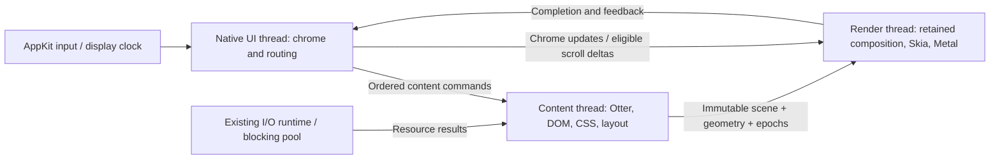

# Browser rendering and thread isolation

Research: 2026-10-14. Otlyra inspected at `12c954b`.
Scope: macOS startup, browser chrome responsiveness, page rendering and scrolling.
The first follow-up removes the
UI's synchronous first-frame/resize wait and splits render/report startup marks;
the audit table describes the inspected baseline, including that former wait.
The second follow-up implements one content owner for normal window startup;
headless Browser APIs remain synchronous.

## Conclusion

Otlyra already has retained display lists, damage tracking, scroll reuse, a render
thread, background I/O and direct Metal rasterization. The missing boundary is
between browser UI and page execution in the inspected baseline: `Browser`
owned `PageWorld` on the native event-loop thread. A render worker alone cannot isolate the address bar
from JavaScript, style or layout running before a frame is submitted.

Fix that boundary while keeping Otter, our DOM/CSS/layout/text stack and Skia.
First measure message delivery and remove synchronous frame waits; then move
page ownership behind a command/snapshot boundary. Independent compositor
scrolling and display-driven scheduling follow that prerequisite.

Windowed startup now constructs Browser and PageWorld on their content owner;
native chrome receives retained scenes and read models. The remaining limits
and acceptance work are recorded in [the implementation follow-up](#content-owner-follow-up).

## Content owner follow-up

`WindowBrowser` keeps address editing, tab-strip interaction and chrome layout
on native UI. Parsing, Otter turns, timers/rAF, DOM/style/layout, page hit testing,
inspector and system-tab rendering stay on the content owner. The local Browser
and its synchronous DOM/driver APIs remain available to screenshots, MCP and
BiDi. No engine changes or `unsafe Send` are needed.

The regression runs an actual 500 ms JavaScript timer callback at 1x and 2x.
While it is still running, UI types an address, creates/selects/closes tabs and
rasterizes two CPU frames. Tests also cover stale document input, pointer/frame
coalescing, copy/paste thread affinity, pre-frame focus, inspector search, native
file-request generations, nonblocking close and cached DPI scaling. About
composites match the synchronous path pixel for pixel at both scales.

This proves separation of native input and chrome from the busy content task.
CPU frame-pump durations are not native input-to-present latency. One content
owner still serializes tabs and inspector work. The retained-damage follow-up
below now accumulates partial updates through render acknowledgements;
Chrome accessibility now retains unchanged document nodes and publishes deltas
as described below. Tab visibility and background rAF now follow the
[visibility contract](#tab-visibility-follow-up) and
[native window propagation](#native-window-visibility-follow-up). Independent scrolling,
content/raster interruption and shutdown persistence remain explicit follow-ups.
An early UI-only frame can be shown before content is ready. Startup reporting
uses the readiness captured on the submitted render job, so late content receipt
cannot reclassify that frame. The first complete content frame retains the strict
budgets; its construction/raster/report intervals are measured together.

### Measurements for this follow-up

Measured on Apple M1, macOS 26.5, release, 1024×768 logical at 2x, with empty
isolated profiles. Each renderer used two warmups and 20 alternating-order
matched process pairs against `dd3fc42`. Both binaries use the same read-only
Otter source snapshot (`23c5a114f769`); the working Otter checkout was left
untouched. Candidate binary SHA-256 starts `e105bf90db60`, control `dfb6b12b687a`.
Values below are p50 / p95 in milliseconds, using nearest-rank percentiles.

| Measurement | GPU control | GPU candidate | CPU control | CPU candidate |
| --- | ---: | ---: | ---: | ---: |
| Process to visibility request | 182.26 / 193.32 | 183.30 / 206.93 | 173.12 / 184.36 | 173.54 / 195.48 |
| Process to first complete content frame report | 278.88 / 295.38 | 275.62 / 303.52 | 261.63 / 278.31 | 259.29 / 273.50 |
| UI frame construction (`chrome_build`) | 7.83 / 7.98 | 0.53 / 0.65 | 7.61 / 8.16 | 0.51 / 0.58 |
| Raster execution (`chrome_raster`) | 27.84 / 31.49 | 32.33 / 37.84 | 24.63 / 28.63 | 28.85 / 31.05 |

The paired median first-frame change is −1.36 ms for GPU and −4.54 ms for CPU.
The UI construction interval excludes page work now performed by the owner;
this is an ownership improvement, not an equivalent reduction in total rendering
work. Raster duration increased, and GPU startup p95 and visibility p95 worsened
in this run. All four strict startup budgets still fail for each renderer
(visibility 50 / 100 ms, first complete frame 100 / 150 ms). Visibility is the
native visibility request; the frame endpoint is UI accounting of a renderer
report, not OS presentation feedback.

Five repeated slow-JS tests per scale measured a 500.81 / 501.31 ms callback at
1x and 500.57 / 500.98 ms at 2x. The UI input batch took 0.26 / 1.45 ms and
0.25 / 0.36 ms respectively, while input plus two CPU frames took 42.13 / 55.50 ms
and 41.45 / 53.93 ms. Every sample completed those operations before the callback
returned. With five samples, p95 is the maximum; these are adapter/CPU-pump
measurements and do not establish native input-to-present or 120 Hz performance.

Local artifacts: `target/startup-content-owner-{gpu,cpu}.json`,
`target/content-owner-build-pair.json`,
`target/content-owner-responsiveness-10.json`, and
`target/content-owner-about-{1x,2x}.png`. Validation covers the full workspace,
the opt-in native GPU/CPU startup smoke, all-target clippy, formatting, and the
seven startup-benchmark protocol tests. The workspace has 1,746 passing tests
and one intentionally ignored desktop smoke; explicitly running that smoke
adds one passing test.

## Retained damage follow-up

The content owner previously replaced every bounded dirty rectangle with full
layer damage, and native composition did the same. This kept coalesced updates
correct but made a keystroke re-rasterize the entire page. Content publications
now preserve their rectangles. Replacing an unconsumed mailbox scene or a cached
UI scene accumulates unacknowledged damage; unknown damage dominates the union.
An unchanged epoch preserves existing damage without adding a new change.

The new `Painter::frame_complete` notification follows renderer completion,
before another frame is composed. Successful frames clear only matching cached
tab/viewport/layer versions. An old completion leaves newer cached changes
pending; dropped or occluded frames acknowledge no pixels. Activation and
geometry changes keep full redraws, including source scenes temporarily scaled
for another DPI. There is one accumulated rectangle per cached layer, with no
unbounded damage journal or new content-thread wait.

Regression coverage compares partial rasterization with a fresh full surface,
including two distant changed rectangles with an intermediate scene skipped,
1x/2x field input, coalesced layout changes, dropped frames and a result arriving
while an older frame is in flight. The shared CPU/GPU damage planner remains
unchanged. Startup still needs a complete first raster; this change targets
subsequent updates and does not establish native input-to-present latency.

Measured on Apple M1 / macOS 26.5 with the debug CPU backend, 900×640 logical,
two warmups and 20 alternating-order same-scene pairs per scale. The control
forces full layer damage for the same prepared scene; both paths use the same
binary and damage planner, and every pair matches pixel for pixel. Timings cover
FramePump rasterization/readback and copying scene handles, excluding native
presentation, content execution, layout and chrome construction. Values are
p50 / p95 in milliseconds, using nearest-rank percentiles.

| Scale | Full layer damage | Partial field damage | Rasterized pixels, full → partial |
| --- | ---: | ---: | ---: |
| 1x | 0.199 / 0.231 | 0.037 / 0.049 | 505,800 → 8,228 |
| 2x | 0.723 / 0.791 | 0.080 / 0.108 | 2,023,200 → 32,912 |

This field fixture redraws 98.37% fewer page pixels. GPU uses the same planner,
but these CPU timings do not measure GPU speed. Raw samples and build metadata
are in `target/content-damage-cpu-pairs.json`. Validation: 1,753 workspace tests
passed, the one ignored desktop smoke passed explicitly for native GPU/CPU,
all-target clippy passed with warnings denied, and the 22 boundary tests passed
after the final test-fixture update. Builds use the earlier read-only Otter
snapshot (`23c5a114f769`), leaving the working Otter checkout unchanged.

## Incremental window accessibility follow-up

Native chrome edits previously cloned the complete retained document into a
window update. The platform then cloned that update again to retain the latest
tree. Window publication now keeps the immutable document Arc and emits only
changed controls, parent child lists, titles or focus. A focus-only update has no
nodes; unchanged wakes/hover return no update. Content preserves equal snapshots
within the same tab/navigation generation. Navigation invalidation removes old
document nodes before the owner can answer.

The platform retains the current graph with `accesskit_consumer` (the existing
adapter dependency, pinned at the same version). Late activation materializes a
complete tree, rather than returning the last partial update. Consumer-backed
tests validate document replacement, removals, focus changes and busy-owner tab
projection. Text fields now carry focus IDs even when empty. Focus is resolved
inside chrome/system surfaces before joining them; their local IDs can overlap.
Bookmark/loading transitions and tab focus-prefix changes invalidate toolbar
semantics. Shared datalist options are exposed under one current field and apply
to that field; exposing the same option under two fields produced an invalid
AccessKit graph and is now covered by a regression.

On Apple M1 / macOS 26.5, the debug publisher comparison used a prepared document
with 10,000 leaf nodes, two warmups and 20 alternating-order matched input pairs.
Full publication emitted 10,003 nodes per edit; incremental publication emitted
one changed address node and zero document nodes. Publisher time p50 / p95 was
1.6679 / 2.9902 ms for the full path and 0.0150 / 0.0242 ms for the incremental
path. This excludes DOM/tree generation, native adapter processing and
presentation, and does not establish native input-to-present latency. Raw samples
and build metadata are in `target/accessibility-chrome-pairs.json`.

Validation: 1,764 workspace tests passed, the desktop GPU/CPU startup smoke
passed explicitly, and all-target clippy passed with warnings denied. Builds use
the read-only Otter snapshot `23c5a114f769`; the working engine checkout is
unchanged. Content still regenerates full accessibility snapshots after semantic
invalidations; equal-snapshot comparison and native initial-tree materialization
still walk the document. Incremental DOM generation remains a separate follow-up.

## Tab visibility follow-up

The document's visibility is initialized from the active tab before parsing
runs its first script. Switching tabs updates the old document to hidden before
exposing the new one, on the content owner. This covers finished pages, parsers
paused at an external script, and parsed documents waiting for subresources.
Encoding reparses preserve visibility. Reordering a tab or selecting the already
active tab emits no extra event; successive ordered tab intents retain their
transitions even within one input batch.

`visibilitychange` reports the new state, bubbles from document to window and
uses the normal event/microtask path. The initial state fires no change event.
Both `addEventListener` and `document.onvisibilitychange` are supported. This
follows the [HTML visibility steps](https://html.spec.whatwg.org/multipage/interaction.html#page-visibility).

The frame pump looks up only the active slot instead of entering every tab's
isolate. Hidden documents retain their animation callbacks, including callbacks
registered during loading. The deferred-load flush also skips hidden frames;
load events and timers still run. Activation resumes queued callbacks with the
normal current frame timestamp, without replaying missed frames. The
[HTML rendering algorithm](https://html.spec.whatwg.org/multipage/webappapis.html#update-the-rendering)
excludes hidden documents before animation-frame callbacks.

Regression coverage uses actual JavaScript and tab commands: forty foreground
frame pumps execute zero callbacks in the hidden animation loop, while its timer
runs and reports hidden. Returning to the tab resumes its pending callback and
Vsync request. Other cases cover background document arrival, a parser-blocking
external script, handler replacement/removal, bubbling and microtasks, encoding
reset, cancellation while hidden, closing/reordering tabs and repeated selection.
The window adapter is tested through its ordered command boundary; visibility
listeners run on `otlyra-content`.

Verification: 1,771 workspace Rust tests passed, plus the opt-in native GPU/CPU
startup smoke; all-target clippy with `-D warnings`, formatting and diff checks
passed. Builds use the same immutable Otter snapshot as the preceding follow-ups;
the working Otter checkout was not edited.

This removes unnecessary background animation execution; it is not an
end-to-end CPU, energy or native input-to-present benchmark. Native window
occlusion/minimization is implemented by the follow-up below. Timer budgets,
media exemptions and visibility performance entries remain follow-ups. One
content owner still serializes page tasks and visibility listeners.

## Native window visibility follow-up

Native window visibility now reaches content through an ordered, window-wide
command. UI immediately stops its Vsync requests while the owner is busy; stale
snapshots cannot reactivate the hidden window. Quick hide/show transitions retain
their visibility events, and duplicate states produce no extra event. Tab
selection stays independent: switching inside a hidden window exposes no page,
and restoration exposes only the selected tab. New documents loaded while hidden
report hidden in their first script.

The native loop uses confirmed occlusion and minimized state, preserving unknown
query results. Focus loss does not hide a visible window. On macOS, winit maps
AppKit's occlusion-state changes to `Occluded`; minimize/restore is queried during
native resize, focus, occlusion and redraw events. Platform support is bounded by
the pinned winit version: occlusion is unavailable on Windows/Wayland, and the
minimized query returns unknown on Wayland. Those unknown states are not inferred
from focus or zero-sized drawable geometry.
[Pinned event source](https://github.com/rust-windowing/winit/blob/7d20408d33210c93bf036335b88ee083ca563a90/winit-core/src/event.rs),
[window state query](https://github.com/rust-windowing/winit/blob/7d20408d33210c93bf036335b88ee083ca563a90/winit-core/src/window.rs),
[AppKit bridge](https://github.com/rust-windowing/winit/blob/7d20408d33210c93bf036335b88ee083ca563a90/winit-appkit/src/window_delegate.rs).

Known-hidden redraw requests submit no raster jobs. Old visual deadlines and
unsubmitted redraws are cancelled; the painter retains its pending damage.
A job already submitted still reports, releasing the flight slot. A completion
while hidden does not acknowledge presentation or satisfy the startup report.
Restoration requests a fresh frame at the current native viewport, keeping the
existing one-job limit. For synchronous painters, timer deadlines wake their
event pump without painting; WindowBrowser's owner schedules its timers itself.
Non-advancing visual deadlines are discarded while hidden to prevent a busy loop.

Tests exercise real JavaScript visibility/rAF/timers and the native command
boundary while content is blocked. Forty hidden pumps execute no rAF callbacks.
A controlled render worker also receives no extra job during forty hidden redraws;
its late completion retains damage, and restoration uses the latest viewport.
Other checks cover loading without spinner Vsync, initial hidden state, tab
changes, duplicate/rapid transitions, unknown native queries and hidden timer
deadlines. These are deterministic protocol checks rather than an energy or
input-to-present benchmark; manual native minimize/restore is not part of them.

Verification: 1,778 workspace Rust tests passed, plus the opt-in native GPU/CPU
startup smoke. All-target clippy with `-D warnings`, formatting and diff checks
passed against the same immutable Otter snapshot; its working checkout was not
edited. These checks do not establish a new startup latency distribution.

Timers and resource loads continue. Hidden scene preparation was addressed in
the following step; timer budgets, exemptions and interruptible content tasks
remain separate work.

## Hidden content preparation follow-up

The content owner's snapshot now distinguishes metadata from a prepared scene.
While the window is hidden it pumps timers, parsing and completed resources but
does not compose content, refresh find geometry or generate document
accessibility. Page style/layout invalidations remain pending. Existing loads
continue; CSS images/fonts discovered only by visual preparation can start later.

Metadata does not replace the UI's retained scene. A tab/navigation change clears
the retired document accessibility; the first visible snapshot prepares the new
tree. Restoration forces full scene damage at the latest viewport, also covering
an unconsumed scene overwritten by hidden metadata. Geometry-bound input can
prepare content explicitly before hit testing or accessibility actions, so a
restore and pointer event in one command batch use current layout.

Tests cover real hidden JavaScript timers moving and changing a field without
additional display-list builds, retained accessibility/list identity, initial
hidden loading, a 2x resize, hidden navigation, same-batch restore/input, and
unconsumed visible damage. Resumed CPU output is compared with a fresh full
surface at 1x/2x. This is functional evidence, not a native energy or latency
distribution. Identical metadata publications were suppressed in the follow-up
below.

Verification: 1,783 workspace Rust tests passed with no failures; all-target
clippy with `-D warnings`, formatting, diff checks and the opt-in native GPU/CPU
startup smoke passed against the same immutable Otter snapshot. The working
Otter checkout was not edited.

## Cookie persistence follow-up

Browser pumps and cookie-removal actions now schedule a revision instead of
serializing, sealing and replacing the cookie file inline. A lazy single writer
coalesces requests to the newest jar state. It copies the jar and revision under
one lock, then releases both jar and scheduler locks for key lookup, formatting,
sealing and I/O. Refused key lookup is remembered; it writes no plaintext and
does not retry indefinitely.

The written revision advances only after successful atomic replacement and sync,
fixing the previous skipped-retry failure. Writes use unique temporary names;
file sync precedes rename and directory sync follows it on Unix. Errors preserve
the pending revision and retry after one second without another browser pump.
Explicit `CookieStore::flush` remains a blocking success/failure barrier for
legacy migration. Its source is removed only after that barrier succeeds.

`WindowBrowser::Drop` still sends shutdown without joining. Normal native CLI
startup retains the content thread handle and joins it after `run_window`
returns; cookie-store destruction drains pending changes on content. Profile
reads and legacy migration remain synchronous during profile loading. Fetch
ownership was addressed in the following step. Independent download saves
and started blocking tasks remain separate shutdown work.

Controlled tests hold a write while forty revisions are scheduled: scheduling
and jar mutation continue, and only the first and latest snapshots are written.
Other tests cover failed replacement and retry of an unchanged revision, retry
without pumping, unscheduled final changes, session-cookie exclusion, refused
keys, a failed worker releasing waiters, legacy migration failure/success,
nonblocking native close and post-loop shutdown durability. These checks prove
ownership and persistence behavior; they do not establish saved-profile startup
or native input-to-present latency distributions.

Verification: 1,794 workspace Rust tests passed, plus the opt-in native GPU/CPU
startup smoke. All-target clippy with `-D warnings`, formatting and diff checks
passed using the same immutable Otter snapshot; its working checkout was not
edited.

## Fetch ownership and shutdown follow-up

Each fetch pool now retains its transport tasks in a `JoinSet` on the existing
shared I/O runtime. Finished handles are reclaimed during normal use. Pool
destruction closes its permit queue, suppresses its waker and aborts without
joining. Closing permits before aborting prevents released slots from starting
queued transports during teardown; other pools and the shared runtime continue.

Native content exits its command loop before cancellation, drains cooperative
transport futures, then drops its cookie store. It discards completed replies
without parsing, running scripts or requesting further resources. Cookie updates
inside native transport finish before the final snapshot. This drain runs on
content's owner; the CLI's join remains after the native event loop returns.
The early failed metadata-handoff path uses the same boundary.

A completion guard sends one failure and wakes the owner when an async transport
panics, so navigation does not wait indefinitely for a missing reply. Teardown
suppresses these wakes and discards cancellation replies. Started blocking
loaders/decoders cannot be interrupted by aborting their awaiting task;
independent download saves and blocking I/O still need an explicit exit policy.

Tests cover active/queued cancellation, isolation of two pools, handle reclamation,
async panic delivery, and a transport cancellation held before changing the
cookie jar. Post-loop shutdown must persist that final change rather than the
earlier file. These tests establish task ownership and final snapshot ordering,
not native input latency or startup performance improvements.

Verification: 1,799 workspace Rust tests passed, plus the opt-in native GPU/CPU
startup smoke. All-target clippy with `-D warnings`, formatting and diff checks
passed against the same immutable Otter snapshot. The working Otter checkout
was not edited.

## Hidden metadata publication follow-up

Snapshots now separate a prepared scene from immutable shared metadata. The
content owner retains its last hidden metadata handle and suppresses identical
publications, avoiding native UI wakes caused by timers or commands that change
only deferred document state. It continues pumping and uses each newly computed
timer deadline locally, even when it publishes nothing.

Equality includes ordered command serials, tabs/loading/navigation/title,
viewport, focus/cursor, find/bookmark state, zoom/theme, work counters and context
menus; document semantics, system descriptions and suggestions use retained
handles. Labels are derived from tabs. System descriptions now reuse a shared
handle while unchanged. Visibility restoration always publishes current data and
a prepared scene; a suppressed hidden publication still invalidates the resumed
scene's full-damage context.

Tests observe no new publication or native wake across one hundred unchanged
hidden commands, including with an open context menu. They verify changed menu
payloads, title, viewport, ordered acknowledgements and projected tabs still
arrive, and restoration publishes again. Existing real timer, damage and 1x/2x
pixel-parity tests remain covered. This proves publication behavior; it is not
a measured background CPU/energy improvement or a timer budget.

Verification: 1,802 workspace Rust tests passed, plus the opt-in native GPU/CPU
startup smoke. All-target clippy with `-D warnings`, formatting and diff checks
passed on the immutable Otter snapshot, leaving its working checkout unchanged.

## Browser accessibility action follow-up

The interface and system-page handlers previously treated native Focus,
Increment and Decrement like activation. Focusing an About button could navigate;
focusing a cookie-removal control could remove cookies. The existing platform
converter already distinguished all four intents, but browser-owned handlers
ignored the action. They now share a resolver using the existing widget focus,
activation and adjustment paths. Page DOM handling remains on its existing path.

Focus changes no setting, navigation or cookie. Activate keeps the click behavior;
range requests use the slider's own step. Disabled/unfocusable nodes and
unsupported adjustments leave focus/model unchanged. Interface headings no longer
advertise Click; enabled focusable controls advertise Focus, and sliders expose
numeric values plus Increment/Decrement. Existing activation helpers retain their
public API.

Range widgets now advance their current value when accepting pointer or keyboard
input. Repeated steps before another frame previously used the old value and
collapsed to one step; they now accumulate and retain clamping. Tests cover About,
cookie removal, settings toggles/ranges, and threaded native New-tab focus versus
activation. Dynamic control/node ids still need semantic identity: their current
layout indices, including focus ids, do not provide a stable queued target.

Verification: 1,807 workspace Rust tests passed, plus the opt-in native GPU/CPU
startup smoke. All-target clippy with `-D warnings`, formatting and diff checks
passed against the same immutable Otter snapshot; its working checkout was not
edited.

## Script viewport compatibility follow-up

Windowed factories are aligned with the shell's requested viewport and chrome
mode before ready loads can run their first scripts. Otlyra's DOM bindings now
expose replaceable `innerWidth`, `innerHeight` and `devicePixelRatio` getters,
using CSS dimensions and native scale multiplied by the document's page zoom.
The viewport excludes chrome and the inspector dock. Each background document
retains its own zoom when another tab is selected.

Resizing updates metrics and invokes window resize listeners on content's owner,
including handlers assigned through `onresize` and their microtasks. Paused
parser runners receive the update; encoding resets retain both viewport and
visibility. Identical dimensions and changes to DPR alone do not fire resize.
Property assignment preserves the script's replacement value on later updates.
This follows the [CSSOM View Window interface](https://drafts.csswg.org/cssom-view/#extensions-to-the-window-interface)
and its [viewport resize steps](https://drafts.csswg.org/cssom-view/#resizing-viewports).

Regression coverage checks the first inline script at 1x/2x with and without
chrome, initially hidden loading, repeated resize and DPR changes, document zoom,
inspector docking, parser blocking and script property replacement. This step
used the requested shell viewport; native scale confirmation is addressed below.

Verification: 1,813 workspace Rust tests passed, plus the native GPU/CPU startup
smoke and seven benchmark-protocol Python tests. All-target clippy with
`-D warnings`, formatting and diff checks passed on the immutable Otter snapshot.

The startup check used three warmups and 20 alternating baseline/candidate pairs
per renderer on Apple M1/macOS 26.5, release, 1024×768 logical at 2x,
`about:about`, isolated profiles and `--no-secrets`. The driver cache was warm;
local background build load was present. Both binaries use Rust 1.96.0 and the
same frozen engine/Skia archive. Workspace packages were explicitly cleaned
between source trees to prevent Cargo from reusing the control executable.
Control SHA-256 begins `c07d20ee18fd`, candidate `ee9a56b8a8aa`.

| Startup, p50 / p95 ms | Control `331c16d` | Candidate |
| --- | ---: | ---: |
| GPU visibility request | 195.35 / 226.23 | 196.28 / 234.33 |
| GPU complete content-frame report | 291.42 / 311.54 | 290.83 / 316.77 |
| CPU visibility request | 183.73 / 198.96 | 181.13 / 197.82 |
| CPU complete content-frame report | 274.03 / 295.33 | 270.05 / 285.88 |

Paired first-frame median changes were −2.59 ms GPU and −7.72 ms CPU. GPU tail
latency worsened; this compatibility change establishes no startup speedup.
All strict startup budgets still fail. The endpoints retain native visibility
request and UI report-accounting semantics. Local artifacts are
`target/startup-viewport-{gpu,cpu}.json` and `target/viewport-build-pair.json`.

## Native initial viewport follow-up

A real-window probe confirmed that the first inline script could read DPR 3
from `--scale-factor 3` while the native startup report said DPR 2. That CLI
parameter belongs to screenshots; native windows must use the OS scale. The
content factory's requested viewport alone could not guarantee that.

Normal native startup now uses `WindowBrowser::spawn_native`. It hands initial
metadata (including palette, pinned appearance, zoom and bookmark state) to
chrome, attaches service wakers without pumping responses, and waits
on content's owner for the existing `SurfaceReady` event. Actual dimensions and
scale are installed before the first script or scene. Network requests may
complete during the wait; their responses remain queued. The buffered appearance,
visibility and input prefix is replayed before the first pump, so scripts and
the initial scene see the OS environment. Chrome projects tab intents immediately,
buffered commands retain order, and close before surface
confirmation discards pending commands and performs the usual fetch shutdown.
The known-viewport `spawn` and `spawn_with_trace` APIs keep immediate execution.

Startup records `content_surface_ready`; the benchmark separates native surface
delivery and content preparation after confirmation. The older
`first_content_scene` interval includes waiting from owner setup and is not a
measure of CPU work. Tests cover the mismatched nominal/confirmed scale at
1x/2x, chrome input before confirmation and early shutdown. Native desktop smoke
loads both About and an inline-script fixture on GPU/CPU; it checks the first
script against actual surface metrics with the screenshot scale forced to 3.

Verification: 1,818 workspace Rust tests, the four-case native GPU/CPU desktop
smoke, all-target clippy with `-D warnings`, formatting, diff checks and seven
Python benchmark tests passed. The frozen engine digest remains `23c5a114f769`.

The final startup comparison repeats the viewport follow-up's setup: three
warmups and 20 alternating pairs per renderer, warm driver cache, isolated
`about:about` profiles and local background build load. Control is `c9f303a`
(SHA-256 `ee9a56b8a8aa`); candidate SHA-256 begins `9dff2e98c5ca`.

| Startup, p50 / p95 ms | Control | Candidate |
| --- | ---: | ---: |
| GPU visibility request | 214.50 / 235.90 | 214.82 / 229.97 |
| GPU complete content-frame report | 321.09 / 358.50 | 329.46 / 350.02 |
| CPU visibility request | 219.99 / 232.23 | 212.99 / 229.86 |
| CPU complete content-frame report | 328.52 / 344.00 | 315.15 / 333.80 |

Paired first-frame median changes are +0.76 ms GPU and −9.54 ms CPU. GPU median
startup is higher in the unpaired quantile; this run establishes correct initial
metrics, not a startup speedup. All strict startup budgets still fail. The
confirmation-to-first-scene interval is 18.60 / 24.60 ms GPU and 15.90 / 25.81 ms
CPU, including replayed environment commands and scene preparation. Native
visibility and renderer-report endpoints keep their previous accounting meaning.
Artifacts: `target/startup-native-surface-{gpu,cpu}.json`,
`target/native-surface-build-pair.json`, and the before/after native DPR probes
in `target/native-metrics-{before,after}.{json,log}`. Earlier pilot binaries and
measurements are retained separately and are not mixed with this final series.

## What the reference browsers do

### Chromium

Browser UI and web-content execution have separate ownership. A renderer main
thread runs JavaScript and the document lifecycle; its compositor can scroll and
animate eligible content independently. Raster work and final aggregation are
separate stages. Chromium's browser UI can combine its main/compositor work on
one thread because long content tasks belong elsewhere. Copying every thread
in Chromium is therefore unnecessary. [RenderingNG architecture](https://developer.chrome.com/docs/chromium/renderingng-architecture)

The compositor keeps an active tree while a pending tree is rasterized. It
activates a coherent update once enough raster work is ready; the old tree can
still scroll or animate meanwhile. This is not a claim that Chromium never
blocks: its commit operation can briefly block the main thread. The useful
distinction is retaining usable output while preparing a replacement, rather
than waiting for an entire new GPU frame in a native event callback.
[Current cc source documentation](https://raw.githubusercontent.com/chromium/chromium/main/cc/README.md)

`BeginFrameArgs` carries frame time, deadline, interval and dispatch/arrival
timestamps. Frame scheduling has an explicit display deadline, not just
“previous render report arrived”. A frame token connects a submitted frame to
presentation feedback. [BeginFrameArgs](https://raw.githubusercontent.com/chromium/chromium/main/components/viz/common/frame_sinks/begin_frame_args.h),
[CompositorFrameMetadata](https://raw.githubusercontent.com/chromium/chromium/main/components/viz/common/quads/compositor_frame_metadata.h)

Startup-critical work has priority over optional initialization. The current
embedder API supports post-startup tasks and explicitly prefers `BEST_EFFORT`
priority for noncritical work. Background pages have visibility-dependent CPU
and wake-up budgets, with exemptions; policy is not simply “stop all timers”.
[ContentBrowserClient](https://raw.githubusercontent.com/chromium/chromium/main/content/public/browser/content_browser_client.h),
[PageSchedulerImpl](https://raw.githubusercontent.com/chromium/chromium/main/third_party/blink/renderer/platform/scheduler/main_thread/page_scheduler_impl.cc)

### Firefox

Current WebRender source separates scene building, render-backend frame building
and GPU rendering. Scene building is asynchronous and reruns when the display
list changes; the render backend combines the scene with current scroll and
animation state. GPU access belongs to the render thread. Its frame pipeline
also includes visibility culling, picture-cache tile dependencies and batching.
[WebRender source documentation](https://raw.githubusercontent.com/mozilla-firefox/firefox/main/gfx/wr/webrender/src/lib.rs)

APZ can adjust previously rendered content while the content main thread is
busy. It needs scroll/hit-test metadata, a displayport beyond the visible area,
and reconciliation of compositor scroll with script-driven scroll. Cancellable
input, passive listeners and `touch-action` determine whether a content
round-trip is required. An unconditional scroll fast path would break page
behavior. [Asynchronous Panning and Zooming](https://firefox-source-docs.mozilla.org/gfx/AsyncPanZoom.html)

Firefox's startup guidance favors lazy initialization, delayed work after first
paint and idle startup. Its about:home cache separates cached initial markup
from later hydration. That is a startup technique, not evidence that all browser
chrome should become HTML. The pre-XUL skeleton window is a Windows feature;
it is not a macOS implementation to copy into Otlyra.
[Browser Startup](https://firefox-source-docs.mozilla.org/browser/BrowserStartup.html),
[about:home startup cache](https://firefox-source-docs.mozilla.org/browser/extensions/newtab/docs/v2-system-addon/about_home_startup_cache.html),
[Skeleton UI platform guard](https://searchfox.org/firefox-main/source/browser/app/profile/firefox.js)

### WebKit / Safari

Web content and the UI process have separate roles. Safari 17 added the GPU
process drawing architecture to macOS Sonoma, including page content, Canvas
and WebGL. Its stated motivation includes isolation of driver access; another
process is not by itself a startup optimization.
[WebKit's Safari 17 announcement](https://webkit.org/blog/14445/webkit-features-in-safari-17-0/#gpu-process)

The current macOS remote-layer implementation receives display-link callbacks
off the main thread and dispatches refresh work to the main run loop. An atomic
pending-dispatch timestamp coalesces callbacks while one is already queued.
This gives a concrete example of display-driven updates without a FIFO of every
missed tick. It does not mean that AppKit work can be moved off its main thread.
[RemoteLayerTreeDrawingAreaProxyMac](https://raw.githubusercontent.com/WebKit/WebKit/main/Source/WebKit/UIProcess/RemoteLayerTree/mac/RemoteLayerTreeDrawingAreaProxyMac.mm)

These are architecture references, not comparative speed measurements. The
RenderingNG article dates to 2021; current source was checked for the specific
tree, deadline, feedback and scheduling contracts above. Firefox's older
graphics overview is not used to infer current process counts or Fission status.
Source links to `main` describe the branch inspected on the research date, not
a promise about every shipping build or platform.

## Otlyra audit baseline

This table records the call paths before the follow-ups above. Windowed content
ownership, asynchronous frame submission and visibility have since changed;
the remaining work is tracked in `BROWSER_UI_PLAN.md`.

| Finding | Evidence in this checkout | Consequence |
|---|---|---|
| Native UI waits for rendering on first frame and each new viewport | [`RESIZE_WAIT` and `redraw`](../crates/otlyra-platform/src/event_loop.rs): `last_submitted != Some(viewport)` calls `wait_report`, capped at 100 ms | The render worker does not keep input responsive during these waits. The first frame also meets the condition. |
| Content JavaScript executes in the UI call chain | [`frame_geom`](../crates/otlyra-app/src/browser/frame.rs) → [`Browser::pump`](../crates/otlyra-app/src/browser/pump.rs) → [`PageWorld::pump`](../crates/otlyra-app/src/browser/world/mod.rs) → [`PageScripts`](../crates/otlyra-script/src/page.rs); `PlatformEvent::Woken` also pumps | A timer/rAF callback delays chrome input and frame construction. [`SCRIPT_TIME_LIMIT`](../crates/otlyra-script/src/host.rs) is 10 seconds; its watchdog interrupts runaway execution but does not provide UI isolation. |
| Style/layout/display-list generation still belongs to the UI | [`page_list`](../crates/otlyra-app/src/browser/frame.rs) calls `PageScene::build_display_list`; [`fragments`](../crates/otlyra-app/src/page/mod.rs) can restyle and lay out | Cached frames are cheap; a cache miss can hold the native loop for the page's work. |
| Background execution lacks a visibility contract | [`run_due_timers` / `run_frame_callbacks`](../crates/otlyra-app/src/browser/world/mod.rs) visit all slots; [`document.hidden` / `visibilityState`](../crates/otlyra-script/src/dom/document.rs) always return false / visible | Background rAF runs on pumps caused by other work. This is both a compatibility gap and unnecessary CPU work, even though `next_frame` does not request Vsync solely for an inactive tab's rAF. |
| Cookie persistence can perform blocking work during a pump | [`Browser::pump`](../crates/otlyra-app/src/browser/pump.rs) calls [`CookieStore::flush`](../crates/otlyra-app/src/cookies.rs), which can unlock, seal, write and rename | Unchanged revisions are cheap; a changed persistent jar can hold the UI. The written revision also advances before file replacement succeeds; the worker migration must fix failure/retry accounting. Measure saved profiles separately from `--no-secrets` startup. |
| Frame building is serialized with completion | [`FrameScheduler`](../crates/otlyra-platform/src/event_loop.rs) allows one in-flight frame and builds its successor after the report | This correctly avoids stale-frame backlog, but does not overlap next scene preparation with rendering. Preserve bounded work while evaluating an active/pending scene. |
| Application work can precede render-report handling | [`proxy_wake_up`](../crates/otlyra-platform/src/event_loop.rs) drains the application inbox before render reports; a Woken event calls `pump` | Potential additional report latency under content load. This is a code-path observation, not an established cause of the empty-profile startup gap. |

Preserve the existing useful boundaries:

- [`RenderThread`](../crates/otlyra-platform/src/render_thread.rs) owns GPU objects
  and rasterization; the direct Metal path avoids CPU readback and upload.
- [`SceneCompositor`](../crates/otlyra-platform/src/compositor.rs) retains layers,
  damage and scroll reuse. [`PageScene::scroll`](../crates/otlyra-app/src/page/scroll.rs)
  already avoids relayout/list rebuilding for ordinary scrolling.
- [`Fetcher`](../crates/otlyra-app/src/fetcher.rs) decodes ordinary fetched images
  with `spawn_blocking`; image decoding is not a missing worker to add again.
- [`io::shared`](../crates/otlyra-app/src/io.rs) owns the lazy shared I/O runtime.
  The deferred font seed already overlaps discovery with native setup.

## What the startup numbers establish

Existing release data: Apple M1, macOS 26.5, 1024×768 at 2x, `about:about`,
isolated profile, `--no-secrets`, warm driver cache; 40 paired fresh GPU launches
against `89be53e`. No new timing series was run for this research.
Raw artifact: `target/startup-platform-complete-gpu-40.json`.

| Candidate interval | p50 | p95 |
|---|---:|---:|
| Process → visibility request | 180.85 ms | 213.30 ms |
| Process → first-frame report handled | 282.52 ms | 316.62 ms |
| Metal instance construction | 0.01 ms | 0.02 ms |
| Surface attached → presenter created | 4.73 ms | 13.14 ms |
| Presenter created → Ready handled in UI | 59.71 ms | 75.84 ms |
| First scene construction | 7.61 ms | 8.49 ms |
| First raster call interval | 25.00 ms | 33.71 ms |

These intervals overlap. Their percentiles cannot be summed to reconstruct a
launch. The raster interval measures the CPU-side raster call, not GPU execution
time from timestamp queries. Ready delivery includes worker scheduling,
report/wake delivery and native dispatch; its cause remains unproven. A
race/deadlock is not established by a long interval. The isolated system-page
case has no page JavaScript, so content isolation alone cannot explain or remove
this particular startup delay.

`first_present_complete` is marked on the UI when it handles the frame report,
after `Queue::present` returns on the worker. That API schedules presentation;
it does not provide a screen-present timestamp. Our metric mixes render/report
delivery and does not establish input-to-photon latency. Keep the existing
startup gate comparable and add separate submit, completion, report-delivery
and supported OS presentation-feedback metrics.
[wgpu 30 Queue::present contract](https://docs.rs/wgpu/30.0.1/wgpu/struct.Queue.html#method.present)

### First implementation follow-up

The asynchronous first-frame/resize path removes the UI's 100 ms report wait.
A controlled-worker test accepts resize/pointer input before worker completion
at 1x/2x, coalesces intermediate viewports and checks the next scene uses the
latest geometry. Temporarily restoring the old wait fails that test.
Native GPU/CPU startup checks also verify the new milestone order.

The follow-up's fixed-build comparison uses the old platform runtime rebuilt
with the same Otter Rust/manifests as the candidate: 40 GPU / 20 CPU alternating
pairs, three warmups. Build hashes/digest are in
`target/async-frames-build-pair.json`. Raw reports are
`target/startup-async-frames-gpu-40.json` and
`target/startup-async-frames-cpu.json`. GPU first-frame p50/p95 are
249.20/274.42 ms before, 252.73/268.16 ms after; the paired delta p50 is -0.44 ms.
CPU values are 244.58/265.53 ms before, 241.73/255.94 ms after. Startup is not
established as meaningfully faster; the functional gain is UI responsiveness.
Later external Otter changes are checked separately from this measured pair.

The new clocks narrow the Ready interval: its posting-to-UI p50/p95 are
56.32/65.82 ms, while the native wake call is 0.001/0.002 ms. First-frame report
delivery is 0.022/0.064 ms. This excludes a slow wake call as the explanation in
this workload; native dispatch and UI callback work still need profiling.
All four strict startup-budget checks still fail.

## Proposed ownership

Start with one content owner separate from native UI. This isolates chrome but
does not isolate tabs from each other; per-site content owners/processes are a
later stability and performance boundary. Construct isolates and thread-local
DOM bindings on their owning thread. Do not move live isolates between threads
or add `unsafe Send` to force the design through.

Publish immutable display lists, hit-test geometry, scroll metadata and the
accessibility/inspector data the UI needs. Attach tab, navigation, viewport and
scene generations so a closed tab, replacement navigation or old resize cannot
publish stale output. Keep paint and hit testing tied to the same scene epoch.
DOM state remains owned once; snapshots are read models, not a second DOM.

Preserve synchronous DOM semantics within a content task, including forced
layout queries. Do not make DOM getters asynchronously return cached guesses.
Between threads use commands and replies; native UI never waits for content.
Coalesce replaceable viewport/scene state; preserve ordered key, button,
navigation and DOM operations. Bound pending scenes rather than enqueueing an
unlimited stream of obsolete frames.

One GPU-owning worker can still be occupied by a heavy page raster. Moving
JavaScript alone will not make chrome drawing preempt that raster. Add bounded
raster work/retained active output after measuring this case; do not share a
live Ganesh context across threads or create speculative GPU worker pools.

## Ordered implementation and acceptance

1. **Separate the clocks and reproduce blocking.** Add produced/sent/wake/
   received/handled report timestamps, frame/input IDs, native callback spans
   and queue depths in diagnostic mode. Profile AppKit launch and the Ready gap
   with Instruments/signposts. Keep tracing overhead outside baseline timings.
   Reproduce a 200–500 ms finite JS callback, slow layout and slow raster while
   typing in the omnibox, switching tabs, scrolling and resizing. Add a
   deterministic slow-render test for event dispatch before completion.

2. **Remove UI waits and blocking persistence.** Replace the 100 ms first-frame/
   resize wait with asynchronous completion and a retained resize policy. Test
   1x/2x resize, display changes, window close and stale-viewport reports before
   accepting any visual tradeoff. Snapshot/coalesce persistent-cookie writes to
   a serialized worker; retain atomic replacement, acknowledge revisions only
   after successful replacement, retry failures and flush pending revisions at
   shutdown. Coordinate keychain interaction separately from disk
   I/O. Native APIs that require AppKit stay on its thread.

3. **Give page work a content owner.** Move `PageWorld`, script turns, parsing,
   style and layout behind commands and immutable scene publications. Migrate
   inspector, accessibility, find/selection and driver access with the same
   ownership boundary. Pass compatibility tests for DOM identity, parser-blocking
   scripts, microtasks, timers, rAF, navigation and synchronous layout queries.
   A finite busy script must no longer stop native chrome input processing.

4. **Add real visibility and compositor input.** Make visibility state/events
   reflect active tab and window state; schedule hidden-page work with an
   explicit policy and resume timestamps. Add eligible compositor scrolling
   using existing retained lists and display bands. Preserve nested scroll
   handoff, passive/cancellable input, hit testing and script scroll changes;
   take the content path when eligibility is unknown. Measure checkerboarding
   and memory growth rather than rasterizing an entire long page speculatively.

5. **Schedule against display deadlines; optimize measured raster.** Extend the
   existing scheduler with display-time/deadline information and bounded
   active/pending updates. Keep the idle loop asleep, coalesce missed display
   ticks and support 60/120 Hz. Evaluate tiles, glyph/image warmup and cheaper
   first-frame drawing only for measured workloads. GPU selection is not the
   priority while backend construction is negligible.

For each behavior change retain CPU fallback and deterministic screenshots,
run the relevant compatibility/interaction tests, and run the native startup
smoke in GPU and CPU modes. Startup changes require at least 20 alternating
baseline/candidate launches, p50/p95 and binary hashes. Measure normal saved
profiles and cold driver caches separately. Report UI event handling, frame
construction, GPU completion and supported presentation feedback separately;
apply the existing 8.33 ms interactive target to the metric it actually names.
The strict 50/100 ms visibility and 100/150 ms first-frame startup budgets remain.
