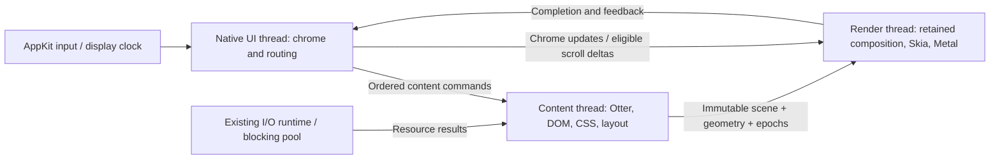

# Browser rendering and thread isolation

Research: 2026-10-14. Otlyra inspected at `12c954b`.
Scope: macOS startup, browser chrome responsiveness, page rendering and scrolling.
The first follow-up removes the
UI's synchronous first-frame/resize wait and splits render/report startup marks;
the audit table describes the inspected baseline, including that former wait.
The second follow-up implements one content owner for normal window startup;
headless Browser APIs remain synchronous.

## Conclusion

Otlyra already has retained display lists, damage tracking, scroll reuse, a render
thread, background I/O and direct Metal rasterization. The missing boundary is
between browser UI and page execution in the inspected baseline: `Browser`
owned `PageWorld` on the native event-loop thread. A render worker alone cannot isolate the address bar
from JavaScript, style or layout running before a frame is submitted.

Fix that boundary while keeping Otter, our DOM/CSS/layout/text stack and Skia.
First measure message delivery and remove synchronous frame waits; then move
page ownership behind a command/snapshot boundary. Independent compositor
scrolling and display-driven scheduling follow that prerequisite.

Windowed startup now constructs Browser and PageWorld on their content owner;
native chrome receives retained scenes and read models. The remaining limits
and acceptance work are recorded in [the implementation follow-up](#content-owner-follow-up).

## Content owner follow-up

`WindowBrowser` keeps address editing, tab-strip interaction and chrome layout
on native UI. Parsing, Otter turns, timers/rAF, DOM/style/layout, page hit testing,
inspector and system-tab rendering stay on the content owner. The local Browser
and its synchronous DOM/driver APIs remain available to screenshots, MCP and
BiDi. No engine changes or `unsafe Send` are needed.

The regression runs an actual 500 ms JavaScript timer callback at 1x and 2x.
While it is still running, UI types an address, creates/selects/closes tabs and
rasterizes two CPU frames. Tests also cover stale document input, pointer/frame
coalescing, copy/paste thread affinity, pre-frame focus, inspector search, native
file-request generations, nonblocking close and cached DPI scaling. About
composites match the synchronous path pixel for pixel at both scales.

This proves separation of native input and chrome from the busy content task.
CPU frame-pump durations are not native input-to-present latency. One content
owner still serializes tabs and inspector work. The retained-damage follow-up
below now accumulates partial updates through render acknowledgements;
UI still merges owned accessibility data. Visibility, independent scrolling,
content/raster interruption and shutdown persistence remain explicit follow-ups.
An early UI-only frame can be shown before content is ready. Startup reporting
uses the readiness captured on the submitted render job, so late content receipt
cannot reclassify that frame. The first complete content frame retains the strict
budgets; its construction/raster/report intervals are measured together.

### Measurements for this follow-up

Measured on Apple M1, macOS 26.5, release, 1024×768 logical at 2x, with empty
isolated profiles. Each renderer used two warmups and 20 alternating-order
matched process pairs against `dd3fc42`. Both binaries use the same read-only
Otter source snapshot (`23c5a114f769`); the working Otter checkout was left
untouched. Candidate binary SHA-256 starts `e105bf90db60`, control `dfb6b12b687a`.
Values below are p50 / p95 in milliseconds, using nearest-rank percentiles.

| Measurement | GPU control | GPU candidate | CPU control | CPU candidate |
| --- | ---: | ---: | ---: | ---: |
| Process to visibility request | 182.26 / 193.32 | 183.30 / 206.93 | 173.12 / 184.36 | 173.54 / 195.48 |
| Process to first complete content frame report | 278.88 / 295.38 | 275.62 / 303.52 | 261.63 / 278.31 | 259.29 / 273.50 |
| UI frame construction (`chrome_build`) | 7.83 / 7.98 | 0.53 / 0.65 | 7.61 / 8.16 | 0.51 / 0.58 |
| Raster execution (`chrome_raster`) | 27.84 / 31.49 | 32.33 / 37.84 | 24.63 / 28.63 | 28.85 / 31.05 |

The paired median first-frame change is −1.36 ms for GPU and −4.54 ms for CPU.
The UI construction interval excludes page work now performed by the owner;
this is an ownership improvement, not an equivalent reduction in total rendering
work. Raster duration increased, and GPU startup p95 and visibility p95 worsened
in this run. All four strict startup budgets still fail for each renderer
(visibility 50 / 100 ms, first complete frame 100 / 150 ms). Visibility is the
native visibility request; the frame endpoint is UI accounting of a renderer
report, not OS presentation feedback.

Five repeated slow-JS tests per scale measured a 500.81 / 501.31 ms callback at
1x and 500.57 / 500.98 ms at 2x. The UI input batch took 0.26 / 1.45 ms and
0.25 / 0.36 ms respectively, while input plus two CPU frames took 42.13 / 55.50 ms
and 41.45 / 53.93 ms. Every sample completed those operations before the callback
returned. With five samples, p95 is the maximum; these are adapter/CPU-pump
measurements and do not establish native input-to-present or 120 Hz performance.

Local artifacts: `target/startup-content-owner-{gpu,cpu}.json`,
`target/content-owner-build-pair.json`,
`target/content-owner-responsiveness-10.json`, and
`target/content-owner-about-{1x,2x}.png`. Validation covers the full workspace,
the opt-in native GPU/CPU startup smoke, all-target clippy, formatting, and the
seven startup-benchmark protocol tests. The workspace has 1,746 passing tests
and one intentionally ignored desktop smoke; explicitly running that smoke
adds one passing test.

## Retained damage follow-up

The content owner previously replaced every bounded dirty rectangle with full
layer damage, and native composition did the same. This kept coalesced updates
correct but made a keystroke re-rasterize the entire page. Content publications
now preserve their rectangles. Replacing an unconsumed mailbox scene or a cached
UI scene accumulates unacknowledged damage; unknown damage dominates the union.
An unchanged epoch preserves existing damage without adding a new change.

The new `Painter::frame_complete` notification follows renderer completion,
before another frame is composed. Successful frames clear only matching cached
tab/viewport/layer versions. An old completion leaves newer cached changes
pending; dropped or occluded frames acknowledge no pixels. Activation and
geometry changes keep full redraws, including source scenes temporarily scaled
for another DPI. There is one accumulated rectangle per cached layer, with no
unbounded damage journal or new content-thread wait.

Regression coverage compares partial rasterization with a fresh full surface,
including two distant changed rectangles with an intermediate scene skipped,
1x/2x field input, coalesced layout changes, dropped frames and a result arriving
while an older frame is in flight. The shared CPU/GPU damage planner remains
unchanged. Startup still needs a complete first raster; this change targets
subsequent updates and does not establish native input-to-present latency.

Measured on Apple M1 / macOS 26.5 with the debug CPU backend, 900×640 logical,
two warmups and 20 alternating-order same-scene pairs per scale. The control
forces full layer damage for the same prepared scene; both paths use the same
binary and damage planner, and every pair matches pixel for pixel. Timings cover
FramePump rasterization/readback and copying scene handles, excluding native
presentation, content execution, layout and chrome construction. Values are
p50 / p95 in milliseconds, using nearest-rank percentiles.

| Scale | Full layer damage | Partial field damage | Rasterized pixels, full → partial |
| --- | ---: | ---: | ---: |
| 1x | 0.199 / 0.231 | 0.037 / 0.049 | 505,800 → 8,228 |
| 2x | 0.723 / 0.791 | 0.080 / 0.108 | 2,023,200 → 32,912 |

This field fixture redraws 98.37% fewer page pixels. GPU uses the same planner,
but these CPU timings do not measure GPU speed. Raw samples and build metadata
are in `target/content-damage-cpu-pairs.json`. Validation: 1,753 workspace tests
passed, the one ignored desktop smoke passed explicitly for native GPU/CPU,
all-target clippy passed with warnings denied, and the 22 boundary tests passed
after the final test-fixture update. Builds use the earlier read-only Otter
snapshot (`23c5a114f769`), leaving the working Otter checkout unchanged.

## What the reference browsers do

### Chromium

Browser UI and web-content execution have separate ownership. A renderer main
thread runs JavaScript and the document lifecycle; its compositor can scroll and
animate eligible content independently. Raster work and final aggregation are
separate stages. Chromium's browser UI can combine its main/compositor work on
one thread because long content tasks belong elsewhere. Copying every thread
in Chromium is therefore unnecessary. [RenderingNG architecture](https://developer.chrome.com/docs/chromium/renderingng-architecture)

The compositor keeps an active tree while a pending tree is rasterized. It
activates a coherent update once enough raster work is ready; the old tree can
still scroll or animate meanwhile. This is not a claim that Chromium never
blocks: its commit operation can briefly block the main thread. The useful
distinction is retaining usable output while preparing a replacement, rather
than waiting for an entire new GPU frame in a native event callback.
[Current cc source documentation](https://raw.githubusercontent.com/chromium/chromium/main/cc/README.md)

`BeginFrameArgs` carries frame time, deadline, interval and dispatch/arrival
timestamps. Frame scheduling has an explicit display deadline, not just
“previous render report arrived”. A frame token connects a submitted frame to
presentation feedback. [BeginFrameArgs](https://raw.githubusercontent.com/chromium/chromium/main/components/viz/common/frame_sinks/begin_frame_args.h),
[CompositorFrameMetadata](https://raw.githubusercontent.com/chromium/chromium/main/components/viz/common/quads/compositor_frame_metadata.h)

Startup-critical work has priority over optional initialization. The current
embedder API supports post-startup tasks and explicitly prefers `BEST_EFFORT`
priority for noncritical work. Background pages have visibility-dependent CPU
and wake-up budgets, with exemptions; policy is not simply “stop all timers”.
[ContentBrowserClient](https://raw.githubusercontent.com/chromium/chromium/main/content/public/browser/content_browser_client.h),
[PageSchedulerImpl](https://raw.githubusercontent.com/chromium/chromium/main/third_party/blink/renderer/platform/scheduler/main_thread/page_scheduler_impl.cc)

### Firefox

Current WebRender source separates scene building, render-backend frame building
and GPU rendering. Scene building is asynchronous and reruns when the display
list changes; the render backend combines the scene with current scroll and
animation state. GPU access belongs to the render thread. Its frame pipeline
also includes visibility culling, picture-cache tile dependencies and batching.
[WebRender source documentation](https://raw.githubusercontent.com/mozilla-firefox/firefox/main/gfx/wr/webrender/src/lib.rs)

APZ can adjust previously rendered content while the content main thread is
busy. It needs scroll/hit-test metadata, a displayport beyond the visible area,
and reconciliation of compositor scroll with script-driven scroll. Cancellable
input, passive listeners and `touch-action` determine whether a content
round-trip is required. An unconditional scroll fast path would break page
behavior. [Asynchronous Panning and Zooming](https://firefox-source-docs.mozilla.org/gfx/AsyncPanZoom.html)

Firefox's startup guidance favors lazy initialization, delayed work after first
paint and idle startup. Its about:home cache separates cached initial markup
from later hydration. That is a startup technique, not evidence that all browser
chrome should become HTML. The pre-XUL skeleton window is a Windows feature;
it is not a macOS implementation to copy into Otlyra.
[Browser Startup](https://firefox-source-docs.mozilla.org/browser/BrowserStartup.html),
[about:home startup cache](https://firefox-source-docs.mozilla.org/browser/extensions/newtab/docs/v2-system-addon/about_home_startup_cache.html),
[Skeleton UI platform guard](https://searchfox.org/firefox-main/source/browser/app/profile/firefox.js)

### WebKit / Safari

Web content and the UI process have separate roles. Safari 17 added the GPU
process drawing architecture to macOS Sonoma, including page content, Canvas
and WebGL. Its stated motivation includes isolation of driver access; another
process is not by itself a startup optimization.
[WebKit's Safari 17 announcement](https://webkit.org/blog/14445/webkit-features-in-safari-17-0/#gpu-process)

The current macOS remote-layer implementation receives display-link callbacks
off the main thread and dispatches refresh work to the main run loop. An atomic
pending-dispatch timestamp coalesces callbacks while one is already queued.
This gives a concrete example of display-driven updates without a FIFO of every
missed tick. It does not mean that AppKit work can be moved off its main thread.
[RemoteLayerTreeDrawingAreaProxyMac](https://raw.githubusercontent.com/WebKit/WebKit/main/Source/WebKit/UIProcess/RemoteLayerTree/mac/RemoteLayerTreeDrawingAreaProxyMac.mm)

These are architecture references, not comparative speed measurements. The
RenderingNG article dates to 2021; current source was checked for the specific
tree, deadline, feedback and scheduling contracts above. Firefox's older
graphics overview is not used to infer current process counts or Fission status.
Source links to `main` describe the branch inspected on the research date, not
a promise about every shipping build or platform.

## Otlyra audit

| Finding | Evidence in this checkout | Consequence |
|---|---|---|
| Native UI waits for rendering on first frame and each new viewport | [`RESIZE_WAIT` and `redraw`](../crates/otlyra-platform/src/event_loop.rs): `last_submitted != Some(viewport)` calls `wait_report`, capped at 100 ms | The render worker does not keep input responsive during these waits. The first frame also meets the condition. |
| Content JavaScript executes in the UI call chain | [`frame_geom`](../crates/otlyra-app/src/browser/frame.rs) → [`Browser::pump`](../crates/otlyra-app/src/browser/pump.rs) → [`PageWorld::pump`](../crates/otlyra-app/src/browser/world/mod.rs) → [`PageScripts`](../crates/otlyra-script/src/page.rs); `PlatformEvent::Woken` also pumps | A timer/rAF callback delays chrome input and frame construction. [`SCRIPT_TIME_LIMIT`](../crates/otlyra-script/src/host.rs) is 10 seconds; its watchdog interrupts runaway execution but does not provide UI isolation. |
| Style/layout/display-list generation still belongs to the UI | [`page_list`](../crates/otlyra-app/src/browser/frame.rs) calls `PageScene::build_display_list`; [`fragments`](../crates/otlyra-app/src/page/mod.rs) can restyle and lay out | Cached frames are cheap; a cache miss can hold the native loop for the page's work. |
| Background execution lacks a visibility contract | [`run_due_timers` / `run_frame_callbacks`](../crates/otlyra-app/src/browser/world/mod.rs) visit all slots; [`document.hidden` / `visibilityState`](../crates/otlyra-script/src/dom/document.rs) always return false / visible | Background rAF runs on pumps caused by other work. This is both a compatibility gap and unnecessary CPU work, even though `next_frame` does not request Vsync solely for an inactive tab's rAF. |
| Cookie persistence can perform blocking work during a pump | [`Browser::pump`](../crates/otlyra-app/src/browser/pump.rs) calls [`CookieStore::flush`](../crates/otlyra-app/src/cookies.rs), which can unlock, seal, write and rename | Unchanged revisions are cheap; a changed persistent jar can hold the UI. The written revision also advances before file replacement succeeds; the worker migration must fix failure/retry accounting. Measure saved profiles separately from `--no-secrets` startup. |
| Frame building is serialized with completion | [`FrameScheduler`](../crates/otlyra-platform/src/event_loop.rs) allows one in-flight frame and builds its successor after the report | This correctly avoids stale-frame backlog, but does not overlap next scene preparation with rendering. Preserve bounded work while evaluating an active/pending scene. |
| Application work can precede render-report handling | [`proxy_wake_up`](../crates/otlyra-platform/src/event_loop.rs) drains the application inbox before render reports; a Woken event calls `pump` | Potential additional report latency under content load. This is a code-path observation, not an established cause of the empty-profile startup gap. |

Preserve the existing useful boundaries:

- [`RenderThread`](../crates/otlyra-platform/src/render_thread.rs) owns GPU objects
  and rasterization; the direct Metal path avoids CPU readback and upload.
- [`SceneCompositor`](../crates/otlyra-platform/src/compositor.rs) retains layers,
  damage and scroll reuse. [`PageScene::scroll`](../crates/otlyra-app/src/page/scroll.rs)
  already avoids relayout/list rebuilding for ordinary scrolling.
- [`Fetcher`](../crates/otlyra-app/src/fetcher.rs) decodes ordinary fetched images
  with `spawn_blocking`; image decoding is not a missing worker to add again.
- [`io::shared`](../crates/otlyra-app/src/io.rs) owns the lazy shared I/O runtime.
  The deferred font seed already overlaps discovery with native setup.

## What the startup numbers establish

Existing release data: Apple M1, macOS 26.5, 1024×768 at 2x, `about:about`,
isolated profile, `--no-secrets`, warm driver cache; 40 paired fresh GPU launches
against `89be53e`. No new timing series was run for this research.
Raw artifact: `target/startup-platform-complete-gpu-40.json`.

| Candidate interval | p50 | p95 |
|---|---:|---:|
| Process → visibility request | 180.85 ms | 213.30 ms |
| Process → first-frame report handled | 282.52 ms | 316.62 ms |
| Metal instance construction | 0.01 ms | 0.02 ms |
| Surface attached → presenter created | 4.73 ms | 13.14 ms |
| Presenter created → Ready handled in UI | 59.71 ms | 75.84 ms |
| First scene construction | 7.61 ms | 8.49 ms |
| First raster call interval | 25.00 ms | 33.71 ms |

These intervals overlap. Their percentiles cannot be summed to reconstruct a
launch. The raster interval measures the CPU-side raster call, not GPU execution
time from timestamp queries. Ready delivery includes worker scheduling,
report/wake delivery and native dispatch; its cause remains unproven. A
race/deadlock is not established by a long interval. The isolated system-page
case has no page JavaScript, so content isolation alone cannot explain or remove
this particular startup delay.

`first_present_complete` is marked on the UI when it handles the frame report,
after `Queue::present` returns on the worker. That API schedules presentation;
it does not provide a screen-present timestamp. Our metric mixes render/report
delivery and does not establish input-to-photon latency. Keep the existing
startup gate comparable and add separate submit, completion, report-delivery
and supported OS presentation-feedback metrics.
[wgpu 30 Queue::present contract](https://docs.rs/wgpu/30.0.1/wgpu/struct.Queue.html#method.present)

### First implementation follow-up

The asynchronous first-frame/resize path removes the UI's 100 ms report wait.
A controlled-worker test accepts resize/pointer input before worker completion
at 1x/2x, coalesces intermediate viewports and checks the next scene uses the
latest geometry. Temporarily restoring the old wait fails that test.
Native GPU/CPU startup checks also verify the new milestone order.

The follow-up's fixed-build comparison uses the old platform runtime rebuilt
with the same Otter Rust/manifests as the candidate: 40 GPU / 20 CPU alternating
pairs, three warmups. Build hashes/digest are in
`target/async-frames-build-pair.json`. Raw reports are
`target/startup-async-frames-gpu-40.json` and
`target/startup-async-frames-cpu.json`. GPU first-frame p50/p95 are
249.20/274.42 ms before, 252.73/268.16 ms after; the paired delta p50 is -0.44 ms.
CPU values are 244.58/265.53 ms before, 241.73/255.94 ms after. Startup is not
established as meaningfully faster; the functional gain is UI responsiveness.
Later external Otter changes are checked separately from this measured pair.

The new clocks narrow the Ready interval: its posting-to-UI p50/p95 are
56.32/65.82 ms, while the native wake call is 0.001/0.002 ms. First-frame report
delivery is 0.022/0.064 ms. This excludes a slow wake call as the explanation in
this workload; native dispatch and UI callback work still need profiling.
All four strict startup-budget checks still fail.

## Proposed ownership

Start with one content owner separate from native UI. This isolates chrome but
does not isolate tabs from each other; per-site content owners/processes are a
later stability and performance boundary. Construct isolates and thread-local
DOM bindings on their owning thread. Do not move live isolates between threads
or add `unsafe Send` to force the design through.

Publish immutable display lists, hit-test geometry, scroll metadata and the
accessibility/inspector data the UI needs. Attach tab, navigation, viewport and
scene generations so a closed tab, replacement navigation or old resize cannot
publish stale output. Keep paint and hit testing tied to the same scene epoch.
DOM state remains owned once; snapshots are read models, not a second DOM.

Preserve synchronous DOM semantics within a content task, including forced
layout queries. Do not make DOM getters asynchronously return cached guesses.
Between threads use commands and replies; native UI never waits for content.
Coalesce replaceable viewport/scene state; preserve ordered key, button,
navigation and DOM operations. Bound pending scenes rather than enqueueing an
unlimited stream of obsolete frames.

One GPU-owning worker can still be occupied by a heavy page raster. Moving
JavaScript alone will not make chrome drawing preempt that raster. Add bounded
raster work/retained active output after measuring this case; do not share a
live Ganesh context across threads or create speculative GPU worker pools.

## Ordered implementation and acceptance

1. **Separate the clocks and reproduce blocking.** Add produced/sent/wake/
   received/handled report timestamps, frame/input IDs, native callback spans
   and queue depths in diagnostic mode. Profile AppKit launch and the Ready gap
   with Instruments/signposts. Keep tracing overhead outside baseline timings.
   Reproduce a 200–500 ms finite JS callback, slow layout and slow raster while
   typing in the omnibox, switching tabs, scrolling and resizing. Add a
   deterministic slow-render test for event dispatch before completion.

2. **Remove UI waits and blocking persistence.** Replace the 100 ms first-frame/
   resize wait with asynchronous completion and a retained resize policy. Test
   1x/2x resize, display changes, window close and stale-viewport reports before
   accepting any visual tradeoff. Snapshot/coalesce persistent-cookie writes to
   a serialized worker; retain atomic replacement, acknowledge revisions only
   after successful replacement, retry failures and flush pending revisions at
   shutdown. Coordinate keychain interaction separately from disk
   I/O. Native APIs that require AppKit stay on its thread.

3. **Give page work a content owner.** Move `PageWorld`, script turns, parsing,
   style and layout behind commands and immutable scene publications. Migrate
   inspector, accessibility, find/selection and driver access with the same
   ownership boundary. Pass compatibility tests for DOM identity, parser-blocking
   scripts, microtasks, timers, rAF, navigation and synchronous layout queries.
   A finite busy script must no longer stop native chrome input processing.

4. **Add real visibility and compositor input.** Make visibility state/events
   reflect active tab and window state; schedule hidden-page work with an
   explicit policy and resume timestamps. Add eligible compositor scrolling
   using existing retained lists and display bands. Preserve nested scroll
   handoff, passive/cancellable input, hit testing and script scroll changes;
   take the content path when eligibility is unknown. Measure checkerboarding
   and memory growth rather than rasterizing an entire long page speculatively.

5. **Schedule against display deadlines; optimize measured raster.** Extend the
   existing scheduler with display-time/deadline information and bounded
   active/pending updates. Keep the idle loop asleep, coalesce missed display
   ticks and support 60/120 Hz. Evaluate tiles, glyph/image warmup and cheaper
   first-frame drawing only for measured workloads. GPU selection is not the
   priority while backend construction is negligible.

For each behavior change retain CPU fallback and deterministic screenshots,
run the relevant compatibility/interaction tests, and run the native startup
smoke in GPU and CPU modes. Startup changes require at least 20 alternating
baseline/candidate launches, p50/p95 and binary hashes. Measure normal saved
profiles and cold driver caches separately. Report UI event handling, frame
construction, GPU completion and supported presentation feedback separately;
apply the existing 8.33 ms interactive target to the metric it actually names.
The strict 50/100 ms visibility and 100/150 ms first-frame startup budgets remain.
